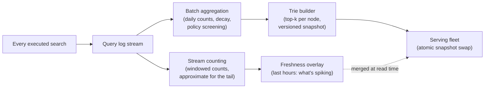
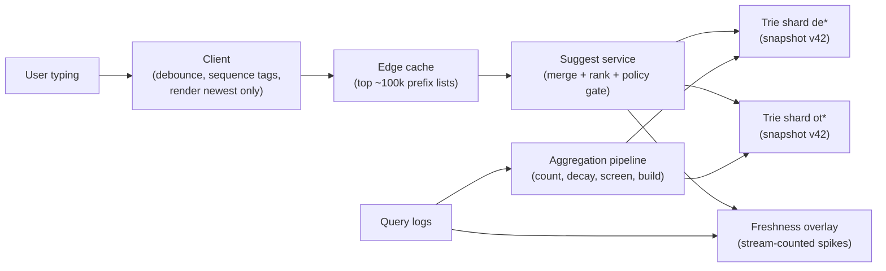

export const meta = {
  slug: 'autocomplete-freshness-safety',
  title: 'Keeping Autocomplete Fresh and Safe: The Pipeline Behind the Dropdown',
  tier: 'intermediate',
  order: 13,
  summary:
    'The second half of the autocomplete design: the log pipeline that learns what the world is asking, the freshness overlay that hears breaking news in minutes, and the policy gate that exists because of one bad December night in 2016.',
  estimatedMinutes: 15,
  difficulty: 3,
  topics: ['system design', 'interview', 'search'],
};

## 9:02 a.m.: the dropdown meets a world it has never seen

Picture a Tuesday morning. At 9:02, something happens — an earthquake, a cup final
draw, a rocket launch, pick your headline — and within ninety seconds, a million
people are typing its name into a search box. Every one of them gets suggestions from
a snapshot built *last night*, from searches counted *up to yesterday*. The new query
isn't in the trie. It isn't in any top-10 list. As far as the dropdown is concerned,
the most important question in the world this morning does not exist.

The previous lesson built the serving half of autocomplete: a trie with precomputed
answers, sharded, cached, answering in tens of milliseconds. It ended with a promise —
the snapshot is *built*, by a pipeline. This lesson builds the pipeline, and it has
three jobs, in ascending order of how badly things go when they're skipped:

1. **Learn** what the world asks (count the query log, with decay).
2. **Stay current** (hear this morning's spike in minutes, not at tomorrow's rebuild).
3. **Stay decent** (never let the counts repeat the ugliest thing in the room back to
   a billion people).

Job 3 has a date attached to it: December 2016. We'll get there — it's the reason
this lesson exists as its own lesson.

## Picture the friend again — the habits that keep them current

Recall the friend who finishes your sentences. Last lesson mechanized two of their
habits: they've heard everything, and they keep shortlists ready. Two more habits run
this lesson:

- **They update with the times.** Last year "how do I get tickets to—" ended with a
  concert; this week it ends with the final. Their shortlist decays the old and
  promotes the suddenly-asked. Mechanized: counting with decay, plus a live overlay
  for what's spiking *now*.
- **They have tact.** Some endings they could say, they don't — the rude, the hateful,
  the harmful. A pure popularity machine has no tact. Mechanized: screening and a
  policy gate that sit *between* the counts and the user, permanently.

## The counting pipeline: from keystrokes to snapshot

Walk it once, slowly:

1. **Log everything.** Every executed search — the final query the user actually ran,
   not every keystroke — is appended to a query log stream. (Keystrokes are noise;
   submitted queries are intent. The message-queues lesson is this stream's home
   turf.)
2. **Stream branch: windowed counting → the freshness overlay.** As searches stream
   in, windowed counters tally them over the last minutes and hours. Counting
   billions of distinct queries exactly, live, is a memory bonfire, so this branch
   counts approximately, using the counting-sketch family (count-min is the famous
   one): keep a small fixed table of counters, hash each query into a few slots and
   bump those counters, and estimate a query's count as the *smallest* of its slots —
   collisions with other queries can only push an estimate up, never down. A tail
   query's count being off by a little changes nothing that matters; exactness is
   spent on the head, the tail gets statistics. This branch's output is the
   **freshness overlay**: the last few hours of fast-rising queries.
3. **Batch branch: daily counts, decay, screening → the trie builder.** On a slower
   cadence, a batch job aggregates the log into per-query counts. Raw all-time counts
   would embalm the past — a query everyone asked in 2019 would outrank what the
   world asked this morning — so counts **decay**: recent days weigh more than old
   ones. Frequency is a memory with a half-life: with a 7-day half-life (an
   illustrative choice, not a law), a search from 7 days ago counts half as much as
   the same search today, and a quarter as much after 14 days. Before the build, the
   aggregated counts pass a **policy screening** stage — denylists and classifiers
   for the categories the policy filter bans (hateful, sexually explicit,
   dangerous). Screening at build time is cheaper than apologizing at press time;
   this lesson's war story is the receipt.
4. **Build and version the trie.** The builder emits a complete new snapshot —
   compressed trie, top-k lists, ID table — stamped with a version. Serving nodes
   load it beside the old one and **swap atomically**; a half-loaded index is never
   served. Versioning sounds like bookkeeping until the first bad build; then it's
   the difference between "roll back to v41" and an incident.

The **freshness overlay** — the stream branch's output — is a small, separate,
in-memory structure holding the last few hours of fast-rising queries. The
score it uses is a ratio, not a count — *this hour's rate versus this query's own
baseline* — so a query jumping from 10 searches a day to 10,000 an hour outranks
queries with a million sleepy all-time searches. At read time the serving tier merges
the snapshot's top-k with the overlay's spiking completions for that prefix. Batch
gives you the truth; the overlay gives you *this morning*. Google's own description
of its predictions lists "trending interest in a query" as a ranking factor ✅ — this
overlay is how a design earns that line.

The merge is the reconciliation point between two honest sources of truth, and it has
rules: the snapshot's list is the base (stable, screened, complete); overlay entries
are admitted only if they pass the same policy screening (spikes are exactly where
manipulation lives — see below); and each overlay entry expires in hours, so
yesterday's spike can't squat in the list after the world moves on.

@@VIDEOSLOT-V3@@

## The night the dropdown embarrassed Google

December 2016. A Guardian journalist, Carole Cadwalladr, is writing about how search
shapes what people believe. She types seven letters — `are jews` — and the dropdown
offers to finish: *are jews evil?* She tries `are women`: the dropdown offers *are women evil?* The suggestions weren't written by anyone at Google. They were **real searches,
counted faithfully** — enough people had asked those questions that a pure popularity
ranking floated them to the top, no human judgment anywhere in the loop. ✅ Google
removed the specific suggestions within days and confirmed the removal to the Guardian
and the Telegraph. ✅ A spokesperson's defence was honest and damning at once:
autocomplete "isn't an exact science," and about 15% of each day's searches are
entirely new — the corpus is a live feed of humanity, unfiltered. ◐

Hold this story next to the pipeline diagram and the design writes itself: **every
stage that touches the ranking is a place where judgment either exists or doesn't.**
Counts without screening made the dropdown a mirror that repeated the ugliest thing
in the room at the volume it was shouted. So the production design layers its defences:

- **Build-time screening** (the batch branch, above): denylists + classifiers over the aggregated
  corpus, before anything reaches a snapshot.
- **Overlay screening:** the freshness path is the manipulable path — a brigade can
  manufacture a "spike" — so overlay promotions pass the same screen, plus a higher
  evidence bar (sustained rate from diverse sources, not a burst from a botnet-shaped
  one).
- **A kill switch:** a human-review channel that can pull a live suggestion in minutes
  without a rebuild — because the next embarrassing suggestion is, by definition, the
  one the classifiers didn't know about.
- **The gate at read time** (previous lesson): policy flags travel with the snapshot,
  and the serving tier drops flagged completions regardless of score.

"How do you keep the suggestions from embarrassing you?" is a top-three follow-up in
this interview. Have the story ready; have the layers designed.

## Unhappy paths, and how the design reconciles them

The previous lesson's walkthrough was the happy path. Here is everything else, and the
layer that absorbs each blow:

- **A story breaks and the snapshot is stale.** The 9:02 a.m. problem from the
  opener. *Reconciliation:* the freshness overlay — stream-counted spikes merge at
  read time, so the dropdown learns in minutes while the snapshot stays the stable
  base. Two sources of truth, reconciled per-request, each with its own TTL.
- **A suggestion goes viral for the wrong reason.** A coordinated campaign pumps a
  hateful query's count until raw frequency would rank it first — December 2016 as a
  load pattern. *Reconciliation:* the policy layers above. Frequency proposes; policy
  disposes — at build time, in the overlay, and at the gate.
- **The counts themselves are gamed.** Bots submit searches to manufacture a trend.
  *Reconciliation:* the pipeline counts *distinct, human-looking* demand — it can
  weight by user diversity and drop traffic that fails the same bot checks the search
  front door uses. A trend that only exists inside one datacenter's worth of fake
  users isn't a trend.
- **A bad build ships.** A buggy aggregation job emits a snapshot with corrupted
  top-k lists. *Reconciliation:* snapshots are versioned and swapped atomically; the
  previous version stays loaded beside the new one, so rollback is a pointer flip —
  and canary shards (a small subset of shards that receive the new snapshot first
  and are watched for errors while the rest of the fleet stays on the old version)
  serve it to a slice of traffic before the fleet commits; only if they stay healthy
  does the rollout continue.
- **The prefix matches nothing.** Fast typists and new words constantly produce
  prefixes with no completions — Mitra & Craswell (2015) call these *rare prefixes*. ◐
  *Reconciliation:* degrade gracefully — back off to the longest prefix that *does*
  have a list, or run a spelling-tolerant match; if still nothing, return empty. The
  friend who finishes your sentences is allowed to say "no idea." Inventing
  completions is the one unforgivable sin.

See the pattern: **the read path is never allowed to improvise, and the write path is
never allowed to be naive.** Every surprise is absorbed by a layer designed for it —
overlay for freshness, screening for safety, versions for bad builds, diversity checks
for gamers.

## Interview follow-ups (they will ask)

- **"Add personalization."** Merge a per-user list — built from the user's own search
  history by the same log pipeline at user scope — ahead of the global top-10,
  clearly budgeted (say 2–3 slots) so personal history sharpens rather than hijacks
  the list. Google's help page confirms personal history is one of its real
  factors. ✅
- **"Your user can't spell."** Typo tolerance: match against the trie with a small
  edit-distance budget, or keep a parallel structure of common misspellings harvested
  from the log (people who typed `desing` then immediately searched `design` taught
  you the mapping for free). Bloomberg's reported 60–80 ms figure already includes
  spelling correction. ◐
- **"Why did Google kill Instant, then?"** Because Instant's other half — repainting
  *results* per keystroke — was removed in July 2017 because of mobile; the
  suggestions survived. Knowing which half died, and why, is the difference between
  trivia and judgment. ✅
- **"What breaks first at 10× scale?"** Not the trie — memory shards linearly. The
  aggregation pipeline and the freshness overlay feel it first: counting and merging
  are the write-heavy parts, and write-heavy parts are where scale goes to collect
  its debts. (The stream-processing lessons later in the course pick this up.)

## The full architecture, both halves

Read it as a loop, not a stack: the world's searches flow down into logs; the pipeline
distills them into snapshots and spikes; the serving tier merges the two at read time;
the answers shape what the world searches next. The dropdown is a mirror the system
holds up to its own users — this lesson was about who polishes the mirror, how often,
and what they're allowed to refuse to reflect.

## Takeaways

1. Suggestions are *learned*, not authored: a log pipeline counts real searches with
   decay, approximates the tail, screens against policy, and ships **versioned
   snapshots** that serving nodes swap atomically.
2. Freshness is a separate layer, not a faster rebuild: a stream-fed overlay scores
   queries by *rate versus their own baseline* and merges at read time, so breaking
   stories appear in minutes while the batch snapshot stays the stable base.
3. Ranking = decayed frequency + trending boost, **gated by policy at every layer** —
   build-time screening, overlay screening, a human kill switch, and the read-time
   gate. December 2016 is the permanent proof that a popularity machine without those
   layers becomes a headline. ✅
4. Every failure has a designed absorber: stale snapshot → overlay; gamed counts →
   diversity weighting; bad build → versioned rollback and canaries; no match →
   graceful backoff to a shorter prefix or an honest empty list.

<Quiz
  lessonSlug="autocomplete-freshness-safety"
  questions={[
    {
      question: "Why does the counting pipeline apply decay to query counts instead of ranking by all-time frequency?",
      options: [
        "All-time counts would embalm the past — decay weights recent days more, so the lists track what the world asks now",
        "Decay makes the counts small enough to fit in the trie",
        "All-time frequency is impossible to compute from logs",
        "Decay is required for the count-min sketch to work",
      ],
      correctIndex: 0,
    },
    {
      question: "A query jumps from 10 searches a day to 10,000 in an hour. Which mechanism promotes it into suggestion lists, and by what signal?",
      options: [
        "The next nightly rebuild; signal: its new all-time count",
        "The edge cache; signal: raw request volume at one node",
        "The freshness overlay; signal: this hour's rate versus the query's own baseline",
        "The policy gate; signal: newsworthiness classification",
      ],
      correctIndex: 2,
    },
    {
      question: "December 2016: Google's dropdown suggested 'are women evil?' What failed, architecturally?",
      options: [
        "The trie returned prefixes in the wrong order",
        "The cache served a stale list from the previous year",
        "The aggregation job was down, so the system improvised suggestions",
        "Ranking was pure popularity over real searches, with no policy screening or gate between the counts and the user",
      ],
      correctIndex: 3,
    },
    {
      question: "A buggy aggregation job ships a snapshot with corrupted top-k lists. What limits the blast radius?",
      options: [
        "Snapshots are versioned and swapped atomically — canary shards first, and rollback to the previous version is a pointer flip",
        "The client debounce hides corrupted lists from most users",
        "The policy gate recomputes any list it finds suspicious",
        "Nothing — a bad build is why the pipeline is rebuilt nightly",
      ],
      correctIndex: 0,
    },
    {
      question: "Where does personalization plug into this design?",
      options: [
        "Into the trie itself, as per-user branches on every node",
        "As a small per-user list, built by the same pipeline at user scope, merged ahead of the global top-10 at read time within a fixed slot budget",
        "Into the count-min sketch, which tracks individual users",
        "It can't — personalization contradicts the snapshot model",
      ],
      correctIndex: 1,
    },
  ]}
/>

---

## Go deeper

- [Message Queues](/lesson/message-queues/) — the log stream this pipeline drinks
  from: durable buffering between the search front door and everything that learns
  from it.
- [Stream vs. Batch: Processing Data at Scale](/lesson/stream-vs-batch/) — this lesson *is* that
  lesson wearing a trench coat: batch truth plus stream freshness, reconciled at
  read time.
- [Design Search Autocomplete](/lesson/search-autocomplete/) — the serving half:
  the trie, the top-k trick, and the 100 ms budget the pipeline must feed.

## Sources & further reading

- Carole Cadwalladr, "Google, democracy and the truth about internet search," *The
  Guardian / The Observer*, December 2016 — the reporting that surfaced the "are jews
  evil" suggestions; Google removed them within days (confirmed to the Guardian and
  the Telegraph; CNET also covered the story). Read it as the case study for why
  ranking needs a policy gate.
- Google Search Help, "How autocomplete predictions work" (support.google.com) —
  trending interest and policy removals are admitted factors in the real system; the
  freshness overlay and the gate in this lesson are how a design earns both lines.
- Fei Cai and Maarten de Rijke, "A Survey of Query Auto Completion in Information
  Retrieval," *Foundations and Trends in Information Retrieval* 10(4), 2016,
  pp. 273–363 — the field's map: ranking models, freshness, personalization, and
  evaluation, organized. Read this when the interview follow-ups start feeling thin.
- Bhaskar Mitra and Nick Craswell, "Query Auto-Completion for Rare Prefixes," *CIKM
  2015*, pp. 1755–1758 — the tail problem: what a system should do when a prefix is
  rare and naive top-k has nothing to say to it. Read it before an interviewer asks
  what your system does with no matches.
- Martin Kleppmann, *Designing Data-Intensive Applications* (O'Reilly, 2017), Ch. 11
  (Stream Processing) — the theory under the counting pipeline: windows, sketches,
  and deriving views from an endless log without drowning in it.
