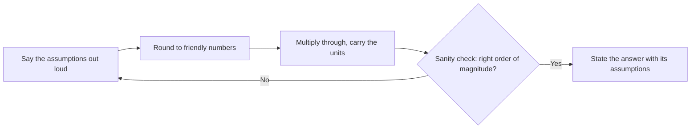

export const meta = {
  slug: 'back-of-envelope-estimation',
  title: 'Back-of-the-Envelope Estimation: The Math That Decides the Design',
  tier: 'beginner',
  order: 8,
  summary:
    'The two-minute estimation skill behind every good design: state your assumptions, round shamelessly, multiply, and sanity-check — the method Fermi used to weigh an atomic blast with falling paper.',
  estimatedMinutes: 20,
  difficulty: 2,
  topics: ['system design', 'interview', 'estimation'],
};

## A bomb, some confetti, and sixty seconds

July 16, 1945, New Mexico desert, just before dawn. Enrico Fermi — one of the great
physicists of the century — is standing at base camp, about ten miles from a tower
holding the first atomic bomb ever built. In his hand: a few scraps of torn-up paper.

The bomb goes off. Flash, heat, the pillar of smoke climbing past the clouds. About
forty seconds later, the blast wave arrives — and Fermi does something that looks like
a magic trick. He drops his paper scraps from about six feet up, some before the wave
arrives, some during, some after, and watches how far the falling pieces get pushed
sideways. The shift: about two and a half meters. From that — paper, falling, in a
desert — he announces his estimate: the blast was equivalent to ten thousand tons of
TNT.

He was right where it mattered. The instruments that survived the test put the blast
energy at roughly his figure, and the total yield, once the soil samples were analyzed,
came to about 18,600 tons — the same order of magnitude, from a man dropping confetti.
Fermi wrote the whole observation up in a short memorandum that survives in the U.S.
National Archives. ✅

This lesson is about that skill. Not the physics — the *estimation*: getting a useful
number, fast, from almost nothing, and knowing how much to trust it. Fermi didn't have
a gift. He had a method, and the method is learnable. By the end of this lesson you'll
have it.

## Why this matters

In [the framework lesson](/lesson/interview-framework/), Step 2 — sketch the route —
asks for "the back-of-envelope math": two minutes of arithmetic against the scope from
Step 1 that tells you which boxes need to be distributed and which are fine as a single
instance. This lesson is that math, taught properly.

Here's why it decides designs. Every architecture question is secretly a size question
in disguise. "Do we need a cache?" depends on how many reads per second are coming.
"Can one database hold this?" depends on how many bytes a year you're adding. "Is
fan-out going to kill us?" depends on one multiplication. Candidates who estimate look
like engineers; candidates who skip it are drawing pictures. Interviewers know the
difference, which is why the framework lesson lists "skipping the math" as a Step 2
anti-pattern with its own name.

The good news: estimation math is not real math. There are no integrals. There is
rounding, multiplying round numbers, and checking that the answer isn't absurd. If you
can estimate what a suitcase weighs before the airline scale proves you wrong, you
already have the core skill — this lesson just gives you reference weights and a
routine.

## The suitcase scale

This lesson's running analogy: **estimating is weighing a suitcase by hand.**

You've done it at an airport. You lift the case, compare it against weights you know —
a bag of sugar is a kilo, a big dog is thirty — and you say "that's about eighteen
kilos." You're never exact. You don't need to be. You need to know whether it's 5, 18,
or 45, because each of those means a different decision: carry-on, check it, or pay the
fee and rethink your life choices.

System estimation works identically:

- **Reference weights** are the handful of numbers you memorize — how long a memory
  read takes, how many seconds are in a day, what a kilobyte of text looks like.
  (The next lesson, the companion reference, is the full set. This lesson teaches you
  to lift.)
- **Rounding** is packing light. Nobody weighs a suitcase to the gram before a flight,
  and nobody estimates with 4.7 × 10⁸ users. You say "about 500 million" and move on —
  the rounding is not sloppiness, it's the technique.
- **The sanity check** is the second lift. "Eighteen kilos" — plausible. "A hundred
  and eighty" — you put the case down and think again. Every estimate in this lesson
  ends with that second lift.

## The method: four moves

Every back-of-envelope calculation, from Fermi's paper to a Google interview room, is
the same four moves in order.

**Move 1 — Say the assumptions out loud.** Users, reads versus writes, bytes per item,
how long you keep things. Assumptions are the estimate; the arithmetic is clerical.
Stating them out loud does two things: it lets the interviewer correct a wrong one
before it poisons everything downstream ("actually, assume a million users, not a
hundred million"), and it converts your guesses into shared decisions — exactly the
Step 1 habit from the framework lesson.

**Move 2 — Round to friendly numbers.** Powers of ten and near-powers: 100 million
users, 2 posts each, 1 KB per post. Keep one significant digit if you must, zero if
you can. Friendly numbers multiply in your head without a calculator, and the
interviewer can follow every step — an estimate nobody can follow earns no credit,
however accurate it secretly is.

**Move 3 — Multiply through, carrying the units.** Users × posts per user = posts.
Posts ÷ seconds = posts per second. Posts × bytes = storage. The units are your
guardrails: if you end up holding "users per byte," you divided somewhere you should
have multiplied. One gift to memorize now: **a day is about 100,000 seconds** (86,400,
rounded the Fermi way). Almost every "per day" figure becomes "per second" with a
single division by 10⁵, and per-second is the unit designs are built in.

**Move 4 — Sanity-check the order of magnitude.** Ask: is this answer the right *size*
of answer? A consumer app doing 10,000 writes a second is plausible; 10 billion is a
supercomputer wearing a trench coat. Compare against anchors you trust — the framework
lesson sized a URL shortener at about 40 writes a second from 100M URLs a month. If
your estimate for a similar system lands a thousand times away from a known anchor,
the bug is in your assumptions, not in the world.

Notice the loop. A failed sanity check doesn't mean start over — it means one
assumption was off, and finding it is the most impressive thing you can do in the
room. Fermi's speed looks like Move 4 performed in advance: historians reconstruct
that he had already worked out what a given paper displacement would mean before the
test (that reconstruction is Katz's, in Sources — Fermi's own memo records only the
observation and the answer). Either way, the estimate was fast because the thinking
was already done. That's the job of the next section: do the thinking now, so the
interview version takes two minutes.

## Reference weights: the latency ladder in human time

One set of reference weights matters more than any other: how long the machine itself
takes to do things. These are the famous latency numbers — published by Peter Norvig,
taught at Google from Jeff Dean's talks — and they span such absurd ranges (a memory
read is a *hundred thousand times* faster than a disk seek) that raw nanoseconds stop
meaning anything. So let's weigh the headline rungs on the suitcase scale: **if
fetching from the fastest cache took one second**, here's how long the rest takes.
(The full table — every rung, with the sources — is the companion reference lesson
that follows this one.) 🔢

| Operation | Real time | If an L1 cache fetch = 1 second |
|---|---|---|
| L1 cache reference | 0.5 ns | 1 second |
| Main memory reference | 100 ns | ~3 minutes |
| Read from a modern SSD (random) | ~50 µs | ~a day |
| Round trip inside one datacenter | ~0.5 ms | ~12 days |
| Disk seek (spinning disk) | ~10 ms | ~8 months |
| Packet: California → Netherlands → back | ~150 ms | ~9½ years |

Read the ladder the way an engineer reads it. Anything measured in minutes is
basically free — that's why we cache in memory and never apologize for it. Anything
measured in days is a design decision: an SSD read per request might be fine, a
million of them is a queue. Anything measured in *months or years* must never happen
on the user's path at all — a single disk seek or cross-ocean round trip, multiplied
by real traffic, is how systems fall over. Every caching layer, every CDN, every
"keep it in one region" decision you'll meet in this course is somebody respecting
this ladder.

Two honest footnotes. First, the SSD rung has moved since the classic table was
written: Dean-era SSDs took ~150 µs (three and a half days, human-scale); modern NVMe
drives do it in the tens of microseconds — same rung of the ladder, better shoes. The
gaps between rungs have barely moved in fifteen years, and the gaps are the lesson.
◐ Second, one rung can never improve: the transatlantic packet is bounded by the
speed of light. Nine and a half years is physics, not engineering debt.

The person who taught the world to *feel* these numbers was Rear Admiral Grace
Hopper, who carried pieces of wire cut to the distance light travels in a nanosecond
— 11.8 inches — and handed them out in lectures so programmers would know what they
were throwing away when they threw away microseconds. A bundle of her nanosecond
wires sits in the Smithsonian today. ◐ Watch her do it:

<VideoCard videoId="JEpsKnWZrJ8" title="Admiral Grace Hopper Explains the Nanosecond" source="Grace Hopper lecture recording" description="Hopper's famous demonstration: a nanosecond is 11.8 inches of wire, a microsecond is 984 feet. The reference weights from the ladder above, made physical." />

## War story: the website that met America unprepared

Now the Fermi story told backwards — what happens when nobody does the envelope math.

October 1, 2013: HealthCare.gov launches. It's the front door for a country's health
insurance marketplace — about as high-stakes as a launch gets, with a date fixed by
law and a president's signature policy riding on it. Millions of people showed up on
day one. The site collapsed almost immediately: error pages, frozen accounts, queues
that went nowhere. By the end of the first day, the number of people who had actually
managed to enroll was **six**. ◐

The postmortems — and there were many, including a full Government Accountability
Office review — did not find one villainous bug. They found something more
instructive: the estimation and testing loop this lesson teaches was never closed.
GAO's report is blunt: end-to-end testing of the whole system **did not occur before
launch**, and pieces were still being finished as the date arrived. ✅ And the load
testing that did happen was sized by hope rather than arithmetic: the identity system
that every single visitor had to pass through — the site's front door — had been
load-tested at roughly **2,000 simultaneous users**, while the demand the launch
actually faced was in the tens of thousands at once, on its way to millions of visits
that first day. ◐

Run the envelope math they skipped. It's three lines, all from this lesson. The
administration later reported about 4.7 million visitors on day one. Spread over even
a generous 10-hour peak, that's ~150 arrivals a second. Now the move nobody made:
each visitor stays for minutes — say a 5-minute session — so the number *inside at
once* is 150 × 300 seconds ≈ **45,000 simultaneous users**. 🔢 Tested capacity: 2,000.
So even this deliberately gentle envelope says the front door was load-tested at
roughly one twenty-fifth of the crowd it should have expected. And the envelope was
the *optimistic* version: the documented record is worse. The administration's
technology chief later put the actual peak at roughly 250,000 people on the site at
once — more than a hundred times the tested load. ◐ Fermi with paper scraps got
within a factor of two of an atomic bomb. A program with hundreds of engineers and a
nine-figure budget under-tested its front door by a factor of twenty-five on the
kindest arithmetic, because the estimate either never happened or never traveled.

The rescue is the postscript that proves the rule: the "tech surge" team that fixed
the site in the following weeks worked by instrumenting everything, measuring real
numbers daily, and burning down a list ordered by measured impact. They didn't write
heroic code first. They estimated, measured, and only then engineered. That's the
order this lesson teaches — and it's the order Step 2 of the framework assumes.

## Worked example: sizing a Twitter-shaped service

Enough stories. Let's run the four moves on the kind of prompt interviews actually
give — "design a social posting service" — and watch an estimate steer real design
decisions. Every number is an assumption, stated out loud, per Move 1.

**The assumptions.** 100 million daily active users. Each posts twice a day on
average. A post, stored with its metadata, is about 1 KB. Each user *reads* a hundred
posts a day — timelines, replies, profiles. Peak traffic runs about 5× the average.
None of these are facts about any real company; they're the scope we'd agree with the
interviewer in Step 1, and changing them changes the design, which is the point.

**Writes.** 100M users × 2 posts = 200M posts a day. Divide by our gift number,
100,000 seconds in a day: **~2,000 posts a second** on average, ~10,000 a second at
peak. Verdict from the ladder of experience: a write rate a small fleet handles
without heroics. Writes are not the problem.

**Storage.** 200M posts × 1 KB = 200 GB of new posts a day. × 365 ≈ **73 TB a year** —
round it to ~100 TB a year once indexes and a couple of replicas join in. Verdict:
real storage, but ordinary. A few dozen drives a year. Storage is not the problem
either.

**Reads.** 100M users × 100 posts read = **10 billion reads a day**. ÷ 100,000 seconds
= **100,000 reads a second**, half a million at peak — fifty reads for every write.
*There* is the design. A read rate like that decides the architecture before any box
is drawn: timelines must be served from memory or cache, not computed from the
database per request, and the fan-out question — when someone with ten million
followers posts, do we push that post into ten million timelines now, or pull it into
each reader's timeline at read time? — is exactly the deep-dive target Step 3 exists
for. Notice the estimate didn't just produce numbers. It *located the hard part*,
which is what Step 2's math is for.

**Sanity check (Move 4).** Does 100,000 reads a second hold up against anchors? The
framework lesson's URL shortener — 100M URLs a month — came out at ~400 reads a
second, and it was a deliberately modest service. A global social network at 250×
that read rate, with fifty-to-one read skew, matches the shape of every real system
in this genre you've read about. The estimate is the right size of answer — which is
all an estimate ever promises: the order of magnitude is where it needs to land, and
it lands there. 🔢

## Practice, in interview form

Three prompts. For each, the deliverable is what an interviewer wants: the one-line
estimate, with its assumptions said out loud. Cover the answers and try first.

1. **"How much storage does a URL shortener need in its first year?"** Assume 100M new
   URLs a month (from the framework lesson) at ~500 bytes a record. → 100M × 12 =
   1.2 billion records × 500 B ≈ **600 GB a year** — a single modest database, no
   sharding heroics on day one. 🔢
2. **"How many messages a second must a chat service carry?"** Assume 50M daily users
   sending 40 messages each. → 2 billion messages a day ÷ 100,000 ≈ **20,000 messages
   a second** average; design for ~100,000 at peak. 🔢
3. **"What network bandwidth does a photo service need just for uploads?"** Assume 1M
   uploads a day at 2 MB each. → 2 TB a day ÷ 100,000 seconds = 20 MB a second ≈
   **160 Mbps of pure upload traffic**, before anyone downloads a single photo. 🔢

If your answers came out within a factor of two or three of these, you did it right —
that's the tolerance this skill runs at. If one came out a hundred times off, find
which assumption moved; that's Move 4 earning its keep.

## Dos and don'ts

**Do:**
- **Say every assumption out loud.** The assumptions are the estimate. Silent numbers
  look like guesses; stated assumptions look like engineering.
- **Round early and openly.** "Call it a hundred million users" is a sentence
  interviewers love — it shows you know which digits don't matter.
- **Carry the units.** Posts per day ÷ seconds per day = posts per second. Units catch
  the multiply-versus-divide slips that sink estimates.
- **End with the sanity check.** Anchor against a system you already sized. Landing
  near a trusted anchor is your proof of work.
- **Let the estimate steer.** The numbers exist to make decisions — "so reads dominate
  fifty to one, which means the budget goes to caching." Say that sentence.

**Don't:**
- **Don't reach for a calculator voice.** Precise-looking numbers (4,173 posts/sec)
  signal false precision. Round numbers signal judgment.
- **Don't estimate in private.** Two silent minutes of arithmetic is the
  silent-cartographer anti-pattern wearing a math costume. Narrate every move.
- **Don't skip the peak.** Averages design demos; peaks design systems. State your
  peak multiplier as an assumption and use it.
- **Don't defend a broken anchor.** If the interviewer corrects an assumption
  ("make it a billion users"), redo the one multiplication live and move on.
  Adjusting fast is the skill being graded.
- **Don't estimate what you won't use.** If no decision depends on a number, don't
  compute it. Estimation is a steering wheel, not a decoration.

## Takeaways

1. Estimation is a method, not a talent: state assumptions, round to friendly numbers,
   multiply through with units, sanity-check the order of magnitude. Fermi weighed a
   bomb blast with falling paper using exactly these moves.
2. A day holds about 100,000 seconds. That one rounding converts almost any "per day"
   figure into the per-second units designs are built in.
3. The latency ladder in human time: memory ≈ minutes, an SSD read ≈ a day, a disk
   seek ≈ months, an ocean crossing ≈ years. Designs are mostly the art of keeping
   the slow rungs off the user's path.
4. HealthCare.gov is the cautionary tale: a front door tested at ~2,000 simultaneous
   users met tens of thousands, because the three-line estimate either never happened
   or never traveled. The rescue team fixed it by measuring first.
5. A good estimate locates the hard part. In the worked example, writes and storage
   were ordinary — the 50-to-1 read skew was the design. Finding that in minute ten is
   the whole game.
6. The full reference weights — the complete latency table, the powers-of-two ladder,
   and the availability "nines" with their downtime math — live in the companion
   lesson that follows this one, **Estimation Reference Numbers**, built to be linked
   from every case study in this course.

<Quiz
  lessonSlug="back-of-envelope-estimation"
  questions={[
    {
      question: "What is the correct order of the four estimation moves?",
      options: [
        "Round to friendly numbers, multiply through, state your assumptions, then sanity-check the result",
        "State assumptions, round to friendly numbers, multiply through with units, sanity-check the order of magnitude",
        "Multiply first with exact figures, round the final answer, check the units, then state your assumptions",
        "Sanity-check the answer first, then work backwards to the assumptions that would have produced it",
      ],
      correctIndex: 1,
    },
    {
      question: "A service gets 300 million actions a day. Using the lesson's rounding (a day ≈ 100,000 seconds), what's the per-second rate?",
      options: [
        "About 30 per second",
        "About 300 per second",
        "About 3,000 per second",
        "About 30,000 per second",
      ],
      correctIndex: 2,
    },
    {
      question: "On the human-scale latency ladder (L1 cache fetch = 1 second), roughly how long is a spinning-disk seek?",
      options: [
        "About 8 months",
        "About 50 seconds",
        "About 6 days",
        "About 9½ years",
      ],
      correctIndex: 0,
    },
    {
      question: "What was the core estimation failure behind the HealthCare.gov launch collapse?",
      options: [
        "The team picked the wrong programming language for the front door, and the rewrite cost them the launch window",
        "The database was sharded too early, before traffic justified it, and the shards fragmented the enrollment data",
        "Too many caching layers made session data inconsistent, so logged-in users kept being signed out at launch",
        "Load testing was sized far below expected demand and end-to-end testing never ran — the estimate of real load never drove the build",
      ],
      correctIndex: 3,
    },
    {
      question: "In the worked example (100M users, 2 posts and 100 reads each per day), what did the estimate reveal as the design's hard part?",
      options: [
        "Write throughput — 2,000 posts a second will overwhelm a single write leader, so the design must shard writes from day one",
        "Storage growth — roughly 100 TB a year of new posts is more than commodity drives can absorb, so cold storage dominates the design",
        "The 50-to-1 read skew — 100,000 reads a second forces caching and makes fan-out the deep-dive target",
        "Peak traffic — the 5× evening peak sits so far above the average that no provisioning strategy can cover it economically",
      ],
      correctIndex: 2,
    },
  ]}
/>

---

## Go deeper

- [The System Design Interview Framework](/lesson/interview-framework/) — the lesson
  before this one. This estimation method is the math its Step 2 asks for; the
  framework is where the numbers get spent.
- [Design a URL Shortener](/lesson/url-shortener/) — the first full case study after
  the foundations. Its sizing (100M URLs a month, ~40 writes a second) is this
  lesson's method at work, and two of the practice prompts above borrow its numbers.
- [Caching Strategies](/lesson/caching-strategies/) — what you build once an estimate
  tells you reads dominate: the ladder says memory is minutes and disk is months;
  caching is how you live in the minutes.

## Sources & further reading

- ✅ Enrico Fermi, "My Observations During the Explosion at Trinity on July 16, 1945"
  (memorandum, U.S. National Archives, Record Group 227) — the primary source for the
  opener: the paper scraps, the 2½-meter shift, the ten-thousand-ton estimate, in
  Fermi's own words. Read it for how much observation he packed into one paragraph.
- ✅ J. I. Katz, "Fermi at Trinity," *Nuclear Technology* 207 (2021) — reconstructs how
  Fermi got from falling paper to a yield, and how his blast estimate compares with the
  radiochemical total (~18.6–25 kt depending on method). Read it to see Move 4 —
  the sanity check — done by historians.
- ✅ Peter Norvig, "Teach Yourself Programming in Ten Years" (norvig.com) — publishes
  the original latency table this lesson's ladder is built from. Jeff Dean's "Numbers
  Everyone Should Know" (Google, c. 2010) carried the same figures into interview
  culture. The full table, with the 2026 notes, is in the companion reference lesson.
- ◐ Colin Scott, "Latency Numbers Every Programmer Should Know" (interactive,
  UC Berkeley) — the classic numbers modeled by year, so you can watch the SSD rung
  improve while the gaps hold. The source behind this lesson's "what changed by 2026"
  footnote: point values drift, orders of magnitude don't.
- ◐ Smithsonian National Museum of American History, collection record for Grace
  Hopper's "nanoseconds" — the bundle of ~11.8-inch wires she handed out from the
  late 1960s on, preserved as an artifact. The Hopper beat above rests on it and on
  her filmed lectures; marked ◐ because the record documents the wires themselves,
  and the lecture stories around them come from the recordings.
- ✅ U.S. Government Accountability Office, *Healthcare.gov: CMS Has Taken Steps to
  Address Problems…* (GAO-15-238, 2015) — the official postmortem: end-to-end testing
  did not occur before launch, testing was inconsistent, oversight lacked estimates of
  the work. Dry prose, devastating content — the true-crime file for the war story.
- ◐ U.S. HHS Office of Inspector General reporting on the HealthCare.gov launch, as
  compiled in Henrico Dolfing's "Case Study 17: The Disastrous Launch of
  Healthcare.gov" — source for the ~2,000-concurrent-user load test on the identity
  system and the six completed enrollments on day one (the latter from CMS briefing
  notes released by the House Oversight Committee). Marked ◐ because these two
  figures reach us through compiled reporting rather than one published table —
  the shape of the failure is not in dispute, and GAO's ✅ findings above stand
  independently of them.
