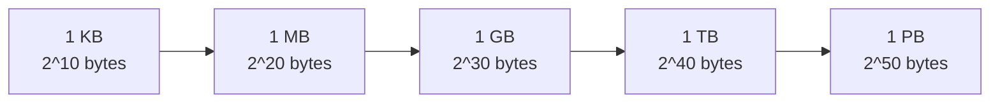

export const meta = {
  slug: 'estimation-reference-numbers',
  title: 'Estimation Reference Numbers: The Pocket Card',
  tier: 'beginner',
  order: 9,
  summary:
    'The three tables every estimation stands on — the full latency ladder, the powers-of-two size ladder, and the availability nines with their downtime math — each with its sources, its 2026 notes, and its confidence marks.',
  estimatedMinutes: 11,
  difficulty: 1,
  topics: ['system design', 'interview', 'estimation'],
};

## Why this page exists

The previous lesson, [Back-of-the-Envelope Estimation](/lesson/back-of-envelope-estimation/),
taught you to lift — state assumptions, round, multiply, sanity-check. But every lift
is measured against reference weights, and that lesson deliberately carried only six
of them. This page is the full set: the pocket card.

Treat it the way pilots treat a checklist card. You don't read it once and throw it
away; you keep it reachable and let your eye land on the row you need. Every
case-study lesson after this one links back here when it says "from the latency
ladder" or "at five nines," so the numbers live in exactly one place and can be
trusted — and re-checked — in one place.

One term before the tables, because everything below leans on it: an **order of
magnitude** is one step of ×10. A memory read and a disk seek differ by about five
orders of magnitude — five ×10 steps, 100 ns against ~10 ms. 🔢 Orders of magnitude
are the currency of estimation: being wrong by 20% is noise, being wrong by ×10 is a
different design.

## Table 1 — The latency ladder, in full

How long the machine takes to do the things designs are made of. These are the
classic numbers published by Peter Norvig and taught at Google from Jeff Dean's
talks; the human-scale column uses the previous lesson's scale (an L1 cache fetch =
1 second), so the two lessons interlock. ✅ for the values as published; the 2026
notes after the table carry their own marks.

| Operation | Real time | If an L1 cache fetch = 1 second |
|---|---|---|
| L1 cache reference | 0.5 ns | 1 second |
| Branch mispredict — the CPU guessed the code's path wrong | 5 ns | 10 seconds |
| L2 cache reference — the CPU's second-fastest shelf | 7 ns | 14 seconds |
| Mutex lock / unlock — one thread waits its turn | 25 ns | 50 seconds |
| Main memory reference | 100 ns | ~3 minutes |
| Compress 1 KB (Zippy, a compression library) | ~3,000 ns | ~100 minutes |
| Send 1 KB over a 1 Gbps network | ~10,000 ns | ~5½ hours |
| SSD random read (classic, SATA era) | ~150,000 ns | ~3½ days |
| Read 1 MB sequentially from memory | ~250,000 ns | ~6 days |
| Round trip inside one datacenter | ~500,000 ns | ~12 days |
| Read 1 MB sequentially from SSD | ~1,000,000 ns | ~3 weeks |
| Disk seek (spinning disk) | ~10,000,000 ns | ~8 months |
| Read 1 MB sequentially from spinning disk | ~20,000,000 ns | ~15 months |
| Packet: California → Netherlands → back | ~150,000,000 ns | ~9½ years |

**How to read it.** Find the two operations your design is choosing between; the
ratio between their rows is the price of the choice. Reading from memory instead of
disk isn't "a bit faster" — it's minutes against months, a factor of about 100,000
for the seek the read replaces. 🔢 And notice the shape: the ladder spans about
eight and a half orders of magnitude, but the gaps bunch — the cache and memory
rungs crowd within a step or two of each other, while the jumps to disk and to
another continent yawn by factors of twenty or thirty. Those wide gaps are where
designs live: crossing one is never an accident, it's the decision.

**What changed by 2026.** The table's *gaps* have barely moved — but three rows
deserve a modern note before you quote them:

- **SSD random read:** the classic 150 µs is a SATA-era figure. A modern NVMe drive
  answers a random read in the tens of microseconds — call it ~50 µs, about a day on
  the human scale. Same rung, faster shoes; quote the modern figure for new designs
  and the classic one when reading older material. ◐
- **Compression:** the classic row used Zippy at ~3 µs per KB. Modern codecs (Zstd)
  do the same job in roughly ~1 µs. Compression got about 3× cheaper; it was never
  the bottleneck rung anyway. ◐
- **The disk rows are now a legacy tier.** Spinning disks still seek in ~10 ms —
  physics of moving parts — but in 2026 they mostly hold archives and backups, not
  user traffic. The rows stay on the card because old systems (and old interview
  material) still speak in disk. ◐
- **Unchanged, and why:** main memory still answers in ~100 ns (modern DDR5 measures
  50–100 ns) and the transatlantic packet is bounded by the speed of light. One is a
  mature technology, the other is physics — neither was ever going to move. ◐

## Table 2 — The powers-of-two ladder

Estimates die in unit conversions, so this ladder does the two conversions you'll
make constantly: bytes to friendly sizes, and counts to friendly counts.

| Power | Bytes (approx.) | Friendly name | A familiar anchor |
|---|---|---|---|
| 2^10 | ~1,000 | 1 KB | A short email, a config file |
| 2^20 | ~1,000,000 | 1 MB | About a minute of MP3 audio |
| 2^30 | ~1,000,000,000 | 1 GB | Roughly 20–30 minutes of HD video |
| 2^40 | ~1 trillion | 1 TB | A typical laptop drive |
| 2^50 | ~1 quadrillion | 1 PB | A small company's whole archive |

Two facts do the daily work. First, **each step up is ×1,024, which estimation
rounds to ×1,000** — so 1 GB ≈ 1 million KB, and converting is just counting commas:
KB → MB → GB → TB, three orders of magnitude per step. 🔢 Second, the counts ladder
is the same shape: **a thousand ≈ 10³, a million ≈ 10⁶, a billion ≈ 10⁹, a trillion
≈ 10¹².** When a problem says "a billion events a day," your hand should write 10⁹
before your brain finishes the sentence. The anchors are illustrative approximations,
not measurements — they exist so a number has a *feel* before it has a design. ◐

Worth memorizing alongside: **a day ≈ 100,000 seconds** (from the previous lesson),
**a million seconds ≈ 11½ days**, and **a billion seconds ≈ 32 years**. 🔢 Those two
conversions quietly power half the sanity checks you'll ever run — "we keep logs for
a billion seconds" should hurt a little when you hear it.

## Table 3 — The nines: availability and its downtime price

When a design says "we need 99.99% availability," it's really making a promise about
downtime. This table prices the promise. The math is one line. A year holds
365 × 24 × 3,600 = 31,536,000 seconds, and downtime is the sliver that's left —
100% minus the promise. Four nines promises 99.99% up, so the downtime fraction is
0.01%: 0.0001 × 31,536,000 = 3,154 seconds ≈ 52.6 minutes a year, and the monthly
column is that divided by 12, ≈ 4.38 minutes a month. Every figure in the table
comes from that one multiplication, so you can redo any of them on a napkin. 🔢

| Availability | Downtime per year | Downtime per month | Say it as |
|---|---|---|---|
| 99% ("two nines") | ~3.65 days | ~7.3 hours | A long weekend, every year |
| 99.9% ("three nines") | ~8.76 hours | ~43.8 minutes | One bad workday a year |
| 99.95% | ~4.38 hours | ~21.9 minutes | About one afternoon a year |
| 99.99% ("four nines") | ~52.6 minutes | ~4.38 minutes | Under an hour a year |
| 99.999% ("five nines") | ~5.26 minutes | ~26 seconds | Five minutes a year — gone before you've read the alert |
| 99.9999% ("six nines") | ~31.5 seconds | ~2.6 seconds | Half a minute a year |

**How to read it.** Each extra nine divides downtime by ten — and multiplies the
engineering bill by far more than ten. Going from three nines to four means your
system may only be down about 4.4 minutes a month: no maintenance windows, no
"restart it and see," deploys that roll back themselves. Five nines is a
*lifestyle* — it's the telephone network's historic standard ◐ — and it costs
like one. So the interview move
is never to recite the table; it's to ask which row the problem actually needs.
Most products are honestly fine at three nines; promising five because it sounds
impressive is how teams buy themselves a very expensive 26 seconds a month.

## Using this card in the interview room

Three moves, one per table:

1. **Quote the rung, not the number.** "A disk seek costs us ~10 ms — on the ladder
   that's the months rung — so this read has to come from memory or SSD" lands
   harder than any raw figure, because it shows the ratio doing the deciding.
2. **Convert out loud.** "A billion events… that's 10⁹, so about 10⁴ a second over a
   day" — narrating the powers-of-two step is the estimate's proof of work.
3. **Price the promise.** When a requirement says "highly available," answer with a
   row: "at four nines we're budgeting 52 minutes of downtime a year — is that the
   target, or is three nines' workday acceptable?" You've just turned a vibe into a
   decision, which is the whole job.

## Dos and don'ts

**Do:**
- **Round from these tables, not from memory of other numbers.** One trusted card
  beats five half-remembered blog posts.
- **Name the era when it matters.** Quoting the SATA-era SSD figure for a 2026
  design is a small, avoidable own-goal — the 2026 notes are on the card for this.
- **Redo the nines math instead of reciting it.** The multiplication is the
  credibility.

**Don't:**
- **Don't quote a rung you can't place.** If you can't say what sits above and below
  a number, you don't know it yet — look it up on the card, out loud, without shame.
- **Don't promise a nine you haven't priced.** Every nine is a budget, in downtime
  and in engineering hours.

## Takeaways

1. The full latency ladder spans 0.5 ns to 150 ms — about eight and a half orders of
   magnitude — and its gaps, not its point values, are what designs are built on.
2. By 2026 the SSD rung improved (tens of microseconds on NVMe) and compression got
   cheaper (Zstd), while memory ~100 ns and the transatlantic ~150 ms stand still.
   Quote the modern row when the design is modern.
3. The size ladder is one shape repeated: ×1,000 per step, KB → MB → GB → TB → PB,
   mirrored by the counts ladder thousand → million → billion → trillion.
4. The nines are priced in downtime: three nines ≈ a workday a year, four ≈
   52 minutes, five ≈ 5 minutes. Each extra nine divides downtime by ten and
   multiplies the engineering bill by much more.
5. This card is the reference for the rest of the course: when a later lesson says
   "from the ladder" or "at four nines," it means these rows.

<Quiz
  lessonSlug="estimation-reference-numbers"
  questions={[
    {
      question: "Roughly how many times faster is a main-memory reference (100 ns) than a spinning-disk seek (~10 ms)?",
      options: [
        "About 100 times — two orders of magnitude",
        "About 1,000 times — three orders of magnitude",
        "About 100,000 times — five orders of magnitude",
        "About 10 million times — seven orders of magnitude",
      ],
      correctIndex: 2,
    },
    {
      question: "A service promises 99.99% availability. How much downtime is it allowed per year?",
      options: [
        "About 52.6 minutes — under an hour a year",
        "About 8.76 hours — one bad workday",
        "About 5.26 minutes — barely one alert",
        "About 3.65 days — a long weekend",
      ],
      correctIndex: 0,
    },
    {
      question: "A dataset holds 2 billion records of about 500 bytes each. Roughly how much storage is that?",
      options: [
        "About 1 GB — a single small drive partition",
        "About 100 GB — a modest database volume",
        "About 10 TB — a small storage array",
        "About 1 TB — one typical drive",
      ],
      correctIndex: 3,
    },
    {
      question: "You're designing in 2026 and need the SSD random-read figure. What should you quote?",
      options: [
        "The classic 150 µs, because the published table is the standard",
        "Tens of microseconds on modern NVMe — the classic figure is SATA-era",
        "About 10 ms, since flash and disk have converged in modern hardware",
        "About 250 µs, to be safely conservative for new designs",
      ],
      correctIndex: 1,
    },
    {
      question: "Why does each additional nine of availability cost so much more than the last?",
      options: [
        "Regulators charge per nine, so the bill is mostly compliance fees and audit costs",
        "Downtime only shrinks linearly while hardware costs grow with traffic and headcount",
        "Each nine divides the downtime budget by ten — four nines leaves ~4.4 minutes a month, no room for maintenance or manual fixes",
        "Cloud providers stop offering discounts, credits, and support tiers once a service passes three nines",
      ],
      correctIndex: 2,
    },
  ]}
/>

---

## Go deeper

- [Back-of-the-Envelope Estimation](/lesson/back-of-envelope-estimation/) — the
  method this card serves. If a row here feels abstract, that lesson's worked example
  spends it.
- [The System Design Interview Framework](/lesson/interview-framework/) — where the
  numbers get used: Step 2's math runs on these tables.
- [Design a URL Shortener](/lesson/url-shortener/) — the first case study; watch its
  sizing lean on Table 2's conversions.
- [Caching Strategies](/lesson/caching-strategies/) — Table 1's minutes-versus-months
  gap, turned into an architecture.

## Sources & further reading

- ✅ Peter Norvig, "Teach Yourself Programming in Ten Years" (norvig.com) — publishes
  the original latency table Table 1 reproduces. Jeff Dean's "Numbers Everyone
  Should Know" (Google, c. 2010) is the same figures in interview-culture form.
  Read Norvig's version for the surrounding essay on why these numbers matter.
- ◐ Colin Scott, "Latency Numbers Every Programmer Should Know" (interactive,
  UC Berkeley) — the numbers modeled year by year; the check behind this card's 2026
  notes on the SSD and compression rows.
- ◐ Modern hardware figures behind the 2026 notes — NVMe random reads in the tens
  of microseconds and DDR5 latency in the 50–100 ns range are the consistent
  figures across 2025–2026 storage and memory coverage (e.g., Tom's Hardware and
  AnandTech SSD reviews; the latency-by-year model in Colin Scott's interactive,
  cited above), and Zstd's ~1 µs-per-KB compression comes from the benchmarks
  published with the zstd project itself. Marked ◐ because point values vary by
  device and stack; the rung placements do not.
- 🔢 The nines table and the seconds conversions are computed in this lesson from
  31,536,000 seconds per 365-day year; no source is needed beyond the arithmetic,
  which is shown so you can check it.
- ◐ The "five nines" standard comes from the telephone industry: Telcordia
  (formerly Bellcore) availability specifications for carrier switching gear set
  the bar in the 1990s, and the term passed from telecom into internet
  infrastructure. Reported consistently across industry references (e.g., Network
  World's "Five Nines, by the book"); marked ◐ because it's compiled industry
  history rather than one primary source. For the deep version, Richard A.
  Thompson's *Telephone Switching Systems* (Artech House, 2000) is the era's
  standard text on how those switching systems were built.
