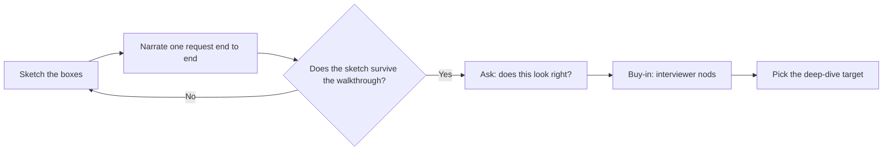
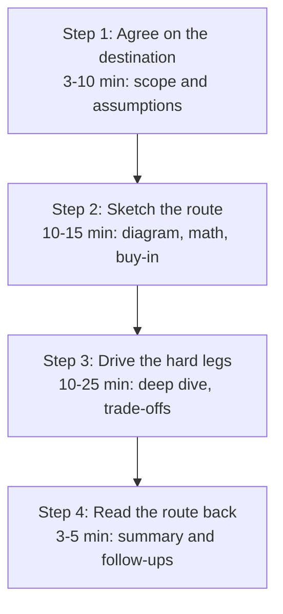

export const meta = {
  slug: 'interview-framework',
  title: 'The System Design Interview Framework',
  tier: 'beginner',
  order: 7,
  summary:
    'The 45-minute playbook for any system design interview: scope first, sketch together, deep-dive where it hurts, and land the wrap-up — with the anti-patterns that sink candidates.',
  estimatedMinutes: 20,
  difficulty: 2,
  topics: ['system design', 'interview'],
};

## Why this matters

Here's the secret nobody tells you before your first system design interview: there is no
right answer. The interviewer isn't holding a reference diagram behind the whiteboard,
waiting to see if yours matches. They're watching something else entirely — how you handle
a problem nobody fully specified, with a stranger, under time pressure, out loud.

That's the whole game. A system design interview is a simulation of the job: a senior
engineer walks into your office with a vague problem — "notifications are falling over,
we need to rethink it" — and you figure it out together. The interview compresses that
into 45 minutes and grades the collaboration, not the boxes.

Once you see it that way, the fear drains out of it. You're not taking an exam. You're
planning a road trip with a friend — and this lesson is the map.

## Picture a road trip

This lesson's running analogy: you and a friend are planning a road trip, and you have to
leave in 45 minutes. You'd never just grab the keys and start driving. First you'd agree
on the destination, who's coming, and the budget — that's scoping. Then you'd sketch the
route on a map together and make sure your friend nods along — that's the high-level
design with buy-in. Then you'd zoom in on the hard legs: the mountain pass, the stretch
with no gas stations — that's the deep dive. And before you pull out of the driveway,
you'd read the plan back: "so we're taking I-70, fueling in Denver, cabin by six" —
that's the wrap-up.

- **The destination** is the requirements: what are we actually building?
- **The sketched route** is the high-level design: the boxes and arrows everyone agrees on.
- **The mountain pass** is the deep dive: the one component where the interview is won or lost.
- **Reading the plan back** is the wrap-up: the summary that proves you were driving, not
  just riding along.

And the 45-minute departure time is real. Spend the whole morning debating snacks and you
never leave the driveway. Every anti-pattern in this lesson is a version of missing the
departure.

## What the interviewer is actually grading

Interviewers score four things, roughly in this order:

1. **Communication.** Did you think out loud? Could a stranger follow your reasoning?
   Silence is the only true failure mode — a quiet genius and an empty chair look
   identical from the interviewer's side of the table.
2. **Scoping.** Did you pin down the problem before solving it? The candidate who asks
   "are we talking hundreds of notifications a day, or hundreds of millions?" before
   drawing a single box is already ahead. Engineers who clarify first are engineers
   who don't build the wrong thing for six months.
3. **Trade-off reasoning.** Every real decision has a cost. "We chose X because Y,
   accepting Z" is the sentence that gets offers. Candidates who present one option as
   obviously correct sound like they've never operated anything at 2 a.m.
4. **Technical depth, applied sparingly.** You need to go deep *somewhere* — one
   component, done properly. The key generator, not the login page. Depth everywhere
   is impossible in 45 minutes, and trying looks like panic.

Notice what's missing: the "correct" architecture. Two strong candidates can draw
different diagrams and both pass, because both showed judgment. The diagram is the
artifact; the thinking is the product.

## Step 1 — Agree on the destination (3–10 minutes)

**Goal:** leave this step with a written scope both of you accept: what the system does,
at what scale, and what you're explicitly *not* building.

**How to execute it.** Ask questions before you draw anything. The best candidates treat
the opening minutes like checking the destination, the passenger list, and the fuel
budget before touching the keys: functional requirements first ("what
are the core features?"), then scale ("how many users? reads vs writes?"), then
constraints ("web, mobile, or both? any latency targets?"). Write the answers down where
the interviewer can see them — the whiteboard is shared memory, and pointing back at it
later ("remember we agreed reads outnumber writes 100 to 1? that's why I'm caching here")
is enormously persuasive. Then state your assumptions out loud and get a nod: "I'm
assuming 10 million daily users and a 100-to-1 read ratio — sound fair?" An assumption
the interviewer blessed is a decision you don't have to defend later.

**Time-box: 3–10 minutes.** Closer to 3 for a familiar problem, up to 10 if the prompt is
genuinely ambiguous. If you're still clarifying at minute 15, you're not being thorough —
you're stalling.

**Anti-patterns:**
- **Grabbing the keys.** Drawing boxes before the scope is agreed. The most common
  failure in system design interviews, and it's fatal: everything downstream inherits the
  wrong destination.
- **The interrogation.** Twenty rapid-fire questions with no synthesis. Ask in clusters,
  then summarize: "so — short links and redirects, 100M new URLs a month, analytics out
  of scope. Correct?"
- **Scope creep by politeness.** "Should I also handle custom aliases? Expiring links? QR
  codes?" Every yes doubles your remaining work. Park extras explicitly: "I'll note
  analytics as a follow-up and keep it out of the core design."

## Step 2 — Sketch the route together (10–15 minutes)

**Goal:** a high-level diagram — clients, API, core services, data stores, cache — that
the interviewer has visibly bought into.

**How to execute it.** Draw the simple version first. Monolith-ish is fine as a starting
sketch; what matters is that you narrate as you draw ("requests come in here, the API
fans out to these two services, reads hit the cache first"). Then do the back-of-envelope
math against the scope from Step 1 — two minutes of arithmetic that tells you which boxes
actually need to be distributed and which are fine as single instances. Walk one request
end to end through the sketch ("a user shortens a URL: POST hits the API, the key service
mints a ticket, we write the mapping, return the short link") and watch for the moment
something in your sketch can't answer the walkthrough — that's your deep-dive target
revealing itself. And get the buy-in explicitly: "does this high-level picture look right
before I go deeper on the key generator?" An interviewer who said yes is now
collaborating, not judging.

**Time-box: 10–15 minutes**, including the estimation math. This is the step candidates
rush — they want to get to the "impressive" deep dive. Resist it. A shaky sketch makes
the deep dive irrelevant.

**Anti-patterns:**
- **The silent cartographer.** Drawing for six minutes without a word. Narrate
  continuously — the interviewer can't grade thinking they can't hear.
- **Alphabet-soup architecture.** Kafka, Redis, Cassandra on the board in minute two,
  before any requirement justifies them. Brand names are not design. If you can't say why
  a component earns its place, it doesn't.
- **Skipping the math.** A high-level design with no numbers is a drawing, not
  engineering. The two-minute estimate is what separates "boxes" from "a system."
- **Designing alone.** Never asking "does this look right?" turns a collaboration back
  into an exam — and you're grading yourself.

## Step 3 — Drive the hard legs (10–25 minutes)

**Goal:** go deep on one or two components where the problem actually lives, showing
trade-off judgment under pressure.

**How to execute it.** You can't go deep everywhere — that's the point. Pick the
component the walkthrough exposed: the key generator in a URL shortener, the fan-out path
in a news feed, the ordering guarantee in chat. Name the options honestly (there are
always two or three credible ones), compare them on the criteria the scope demands, and
pick one *for stated reasons*: "I'm choosing the dedicated key service over hashing
because our write path can't afford a collision check on every insert at this scale, and
I'm accepting the extra service to operate." Then chase the failure modes the interviewer
will probe: what happens when this component dies, what happens at 10× the traffic,
where's the bottleneck. Let the interviewer steer — if they keep asking about the cache,
the cache is the interview now. Follow them.

**Time-box: 10–25 minutes.** This is the biggest block because it's the substance. But
it's capped: at minute 35 you must be wrapping up, no matter how interesting the mountain
pass is.

**Anti-patterns:**
- **Rabbit-holing.** Fifteen minutes on the perfect cache-eviction policy while the
  database design is a blank box. Depth is scored per component chosen wisely, not per
  minute spent.
- **The tourist.** Touching every component for ninety seconds each. That's Step 2
  repeated louder, not a deep dive.
- **Defending instead of reasoning.** Folding at the first pushback — or the opposite,
  clinging to a choice the interviewer just falsified. The graded move is: acknowledge
  the objection, adjust the design, state the new trade-off. Flexibility under pressure
  is the job.
- **Over-engineering the pass.** Designing for a billion users when the scope said ten
  million. Match the depth to the scope you agreed in Step 1 — the interviewer is
  watching whether you remember your own destination.

Step 3 is graded on trade-off reasoning — the "we chose X because Y, accepting Z"
sentence. If you want to hear what world-class trade-off reasoning sounds like, spend
an hour with Martin Kleppmann:

<VideoCard videoId="SVOrURyOu_U" title="Designing Data-intensive Applications with Martin Kleppmann" source="Pragmatic Engineer" description="Kleppmann on the tradeoffs behind modern infrastructure — an hour of exactly the 'we chose X because Y, accepting Z' reasoning Step 3 is graded on." />

## Step 4 — Read the route back (3–5 minutes)

**Goal:** a crisp summary that proves the design hangs together, plus honest notes on
what you'd do with more time.

**How to execute it.** With a few minutes left, stop designing and summarize: the scope,
the key decisions and why, the component you went deep on, the trade-offs you accepted.
Then name the follow-ups yourself before the interviewer does — "with more time I'd add
analytics as a separate pipeline, harden the key service's failover, and load-test the
redirect path." Ending on self-identified improvements signals something powerful: you
know the design isn't perfect, and you know exactly where it isn't. That's
senior-engineer behavior.

**Time-box: 3–5 minutes.** Start watching the clock at minute 35 and reserve the ending
deliberately. The summary is not leftover time — it's a scheduled stop.

**Anti-patterns:**
- **Trailing off.** "...and yeah, that's basically it?" A design with no summary reads
  as a design the candidate couldn't hold in their head.
- **The surprise feature.** Introducing a brand-new component in the wrap-up ("oh, and
  we'd add a message queue here"). If it wasn't in the design, it doesn't exist. Mention
  it as a follow-up or not at all.
- **Apologizing for the design.** "This probably wouldn't work at real scale but…" —
  you scoped it, you reasoned it, stand behind it. Name limitations as engineering facts,
  not confessions.

## The 45-minute map

Here's the whole trip on one dashboard. Print it mentally; glance at the clock at each
boundary.

| Step | What you're doing | Minutes | You're done when |
|---|---|---|---|
| 1. Agree on the destination | Clarify requirements, fix scope, state assumptions | 3–10 | Both of you accept a written scope |
| 2. Sketch the route | High-level diagram, back-of-envelope math, walkthrough, buy-in | 10–15 | Interviewer nods at the sketch |
| 3. Drive the hard legs | Deep dive on 1–2 components, trade-offs, failure modes | 10–25 | One component designed properly, objections handled |
| 4. Read the route back | Summary, decisions recap, follow-ups | 3–5 | You stop with time to spare, not because time ran out |

Two things to notice. First, the steps feed each other: the scope justifies the sketch,
the sketch's walkthrough picks the deep-dive target, the summary replays all three. A
candidate who treats them as separate phases — clarifying, then forgetting the scope —
loses the thread. Second, the clock is a design constraint like any other. Managing it
visibly ("we're at 20 minutes, let me lock the sketch and go deep on the key generator")
is itself a scored skill: it's what running a real design review feels like.

## Your question bank

You don't need brilliant improvised questions. You need a bank of reliable ones, sorted
by problem family. Steal these; they're yours now.

**Every problem, always:**
- What are the two or three core features? Everything else is a follow-up.
- What's the scale — users, reads per second, writes per second?
- What's the read-to-write ratio? (This one number shapes more designs than any other.)
- Web, mobile, or both? Any latency targets?

**Storage-heavy** (Drive, photo sharing, URL shortener):
- How much data per user, and how long do we keep it?
- How much of it is hot vs archival? (The answer decides your storage tiers.)
- Do we need strong durability guarantees, or is best-effort acceptable?

**Read-heavy** (news feed, search, CDN-shaped problems):
- How fresh must reads be — seconds, minutes, "eventually"?
- What's the fan-out shape: a few celebrities with millions of followers, or everyone
  roughly equal? (The whale problem lives here.)
- Cacheable? What's the hit ratio likely to be?

**Real-time / interactive** (chat, collaborative editing, live location):
- What latency is "real-time" here — under 100 ms, under a second?
- How many concurrent connections, not just total users?
- What happens on disconnect — resume, replay, or start over?

**Analytics / aggregation** (ad clicks, metrics pipelines):
- Is this streaming or batch — do we need answers in seconds, or is tomorrow fine?
- Event time or processing time? (Late-arriving data is the whole problem.)
- Approximate answers acceptable, or must every count be exact?

Ask in clusters of two or three, then summarize back. The bank gets you started; the
summary proves you listened.

## Watch it run: TinyURL in 45 minutes

Let's drive the whole route on a problem you know —
[Design a URL Shortener](/lesson/url-shortener/). Listen for what each step *sounds
like*.

**Minutes 0–7 — the destination.** "So the core is two operations: shorten a long URL,
redirect a short one back. Let me fix the scale: say 100 million new URLs a month? And
reads outnumber writes — ten redirects per URL? I'll assume web and mobile both, no
strict latency target beyond snappy redirects. Analytics, custom aliases, expiring links
— I'll park those as follow-ups, not day-one scope. Fair?" The interviewer nods.
Destination agreed, in six minutes.

**Minutes 7–20 — the sketch.** You draw client, API, key service, database, cache. Then
the math, out loud: "100 million a month is about 40 writes a second — writes are
trivial. Reads are 400 a second average, maybe a thousand at peak. Ten-to-one
read-heavy, so the redirect path gets the cache budget. Storage: 12 billion URLs over
ten years at ~500 bytes each is about 6 TB — shardable, no heroics needed." You walk one
shorten and one redirect through the boxes. "Does this high-level picture look right
before I go deeper?" Nod. Route sketched, math done, buy-in secured.

**Minutes 20–38 — the hard leg.** The walkthrough exposed it: key generation is the crux.
"Three options: hash the URL, a shared counter, or a dedicated key service. Hashing gives
free dedup but every insert pays a collision check. The counter is simple but it's a
single choke point — and sequential keys are enumerable, anyone could scrape every link.
I'll take the dedicated key service: each server mints from its own slice of the keyspace
and app servers fetch keys in batches. I'm accepting one more service to operate in
exchange for no coordination on the write path." The interviewer pushes: "what if a key
server dies?" You adjust: slices are pre-allocated, a dead server's slice just sits
unused until recovery — no other server can mint its keys, so no duplicates, only reduced
capacity. Trade-off stated, objection absorbed.

**Minutes 38–43 — read it back.** "So: shorten and redirect at 100M URLs a month,
read-heavy ten to one. API fronting a key service with disjoint keyspace slices, sharded
mapping store, cache on the redirect path. Deep dive was key generation — batch-minted
keys, no per-write coordination, dead servers fail safe. With more time: analytics as a
separate pipeline, and I'd load-test the redirect path at 10× before trusting the cache
sizing." Done with two minutes to spare. That's what passing sounds like.

Notice the back-of-envelope moment in Step 2 — forty writes a second, 6 TB over ten
years. That two-minute calculation is what told the candidate the redirect path deserved
the cache and the database didn't need heroics. Estimation isn't a party trick; it's how
the sketch earns the word "design." (The full technique gets its own lesson — the
upcoming back-of-envelope reference.) The latency figures behind that kind of math come
from one famous talk — Jeff Dean's Velocity keynote on why the 99th percentile, not the
average, decides whether a system feels fast:

<VideoCard videoId="1-3Ahy7Fxsc" title="Achieving Rapid Response Times in Large Online Services — Jeff Dean, Velocity 2014" source="O'Reilly Media" description="The talk behind the latency numbers: why tail latency dominates at scale, and the techniques Google uses to tame it." />

And if you'd rather watch the whole route driven on a whiteboard, here's the same
problem — a URL shortener — worked through in this lesson's four beats:

<VideoCard videoId="qSJAvd5Mgio" title="Design a URL Shortener (Bitly) - System Design Interview" source="NeetCodeIO" description="The URL-shortener problem in this lesson's four beats — gather requirements, API design, high-level design, deep dives — worked on a whiteboard." />

## Dos and don'ts

**Do:**
- **Think out loud, always.** Narrate the reasoning, not just the conclusions. "I'm
  choosing X because…" is the highest-value sentence in the interview.
- **Treat the interviewer as your road-trip friend.** Ask, check, adjust. Collaboration
  is scored; solo brilliance is invisible.
- **Write the scope down and point at it.** The whiteboard is shared memory — use it to
  anchor later decisions.
- **Name trade-offs explicitly.** Every "we chose X" needs its "accepting Y." That's the
  sound of experience.
- **Manage the clock visibly.** Calling out the time shows you can run a meeting, not
  just a whiteboard.
- **End early rather than trail off.** A crisp finish beats a design that dies at minute
  45 mid-sentence.

**Don't:**
- **Don't go silent.** Six quiet minutes of drawing is six minutes of zero signal. If
  you're thinking, say you're thinking.
- **Don't start driving before the destination is agreed.** Boxes before scope is the
  classic fail.
- **Don't name-drop infrastructure.** Kafka doesn't earn points; justified Kafka does.
- **Don't defend a falsified choice.** When the interviewer breaks your design, thank the
  breakage — adjusting under pressure is the job.
- **Don't gold-plate.** Designing for a billion users when the scope said ten million is
  not ambition, it's not listening.
- **Don't apologize for the design.** Limitations are engineering facts. State them, don't
  confess them.

## Takeaways

1. A system design interview grades collaboration under ambiguity — communication,
   scoping, and trade-off reasoning — not the "right" diagram.
2. Run the four steps in order: agree on the destination (scope, 3–10 min), sketch the
   route and get buy-in (high-level + math, 10–15 min), drive the hard legs (deep dive
   on 1–2 components, 10–25 min), read the route back (summary + follow-ups, 3–5 min).
3. Each step has a signature failure: grabbing the keys (drawing before scoping), the
   silent cartographer (drawing without narrating), rabbit-holing (depth in the wrong
   place), trailing off (no summary). Learn their shapes so you can catch yourself
   mid-step.
4. Keep a clarifying-question bank by problem family and ask in clusters — then summarize
   back to prove you listened.
5. The back-of-envelope math in Step 2 is what turns boxes into a design: two minutes of
   arithmetic decides where the engineering budget goes.
6. Manage the clock out loud. Starting the wrap-up at minute 38 on purpose is a scored
   skill.

<Quiz
  lessonSlug="interview-framework"
  questions={[
    {
      question: "An interviewer asks you to design a notification system. What's your best first move?",
      options: [
        "Sketch the high-level architecture so you have something to react to",
        "Ask which kinds of notifications and what scale, then write down an agreed scope",
        "Estimate the numbers first — QPS and storage drive every later decision",
        "Pick the message queue technology, since that's the crux of this design",
      ],
      correctIndex: 1,
    },
    {
      question: "Why does the framework insist on getting the interviewer's buy-in at the end of Step 2?",
      options: [
        "It uses up time so the deep dive feels shorter by comparison",
        "Interviewers are required to approve each phase before you continue",
        "An interviewer who agreed to the sketch is collaborating, not judging — and the walkthrough picks your deep-dive target",
        "It proves you can draw boxes quickly under pressure",
      ],
      correctIndex: 2,
    },
    {
      question: "You're 25 minutes in and deep in cache-eviction policies while the database is still a blank box. Which anti-pattern is this?",
      options: [
        "Rabbit-holing — depth in the wrong place while core components stay blank",
        "Grabbing the keys",
        "The silent cartographer",
        "The surprise feature",
      ],
      correctIndex: 0,
    },
    {
      question: "The interviewer points out a flaw that breaks your chosen key-generation approach. What scores best?",
      options: [
        "Defend the original choice — changing your mind looks indecisive",
        "Pivot to a completely different architecture to show flexibility",
        "Note it as a follow-up and move on quickly",
        "Acknowledge the objection, adjust the design, and state the new trade-off",
      ],
      correctIndex: 3,
    },
    {
      question: "Which of these is the strongest 'read the route back' closing?",
      options: [
        "A quick apology that the design wouldn't survive real production traffic",
        "One new component you just thought of, added to the diagram",
        "Scope recap, key decisions with reasons, the deep-dive component, trade-offs accepted, and self-identified follow-ups",
        "Asking the interviewer whether they have any feedback on your performance",
      ],
      correctIndex: 2,
    },
  ]}
/>

---

## Go deeper

This lesson was the map; these are the territories. Each one runs the framework end to
end:

- [Design a URL Shortener](/lesson/url-shortener/) — the worked example from this
  lesson, expanded into a full interview simulation with the key-generation deep dive.
- [Designing Chat at Scale](/lesson/designing-chat-at-scale/) — watch the framework
  handle real-time constraints: presence, fan-out, and ordering guarantees.
- [Scaling a Web Service](/lesson/scaling-web-service/) — the building blocks the
  framework's Step 2 sketch is made of: load balancing, caching, and sharding.

## Sources & further reading

- Gayle Laakmann McDowell, *Cracking the Coding Interview*, 6th ed. (CareerCup, 2015),
  ch. "System Design and Scalability" — the interview format this lesson's framework
  follows: scoping questions, estimation, and iterative deepening.
- Martin Kleppmann, *Designing Data-Intensive Applications* (O'Reilly, 2017) — the
  trade-off reasoning the deep dive is graded on: replication, partitioning, and
  consistency choices with their costs stated.
- Jeff Dean, "Numbers Everyone Should Know" (circulated at Google, c. 2010; widely
  reproduced) — the latency figures behind the back-of-envelope math in Step 2.
- Jeff Dean and Luiz André Barroso, "The Tail at Scale," *Communications of the ACM*,
  2013 — the paper behind Dean's keynote above: why the 99th percentile decides whether
  a system feels fast, and the techniques Google uses to tame it. Read this and Step 2's
  latency math stops feeling like trivia.
- Giuseppe DeCandia et al., "Dynamo: Amazon's Highly Available Key-Value Store," SOSP
  2007 — the canonical example of stating trade-offs out loud: every choice in Dynamo is
  presented as "we chose X, accepting Y." Read it as a masterclass in the sentence this
  lesson says gets offers.
- Google, *Site Reliability Engineering* (O'Reilly, 2016), ch. 22, "Addressing Cascading
  Failures" — "what happens when this component dies," asked and answered at Google
  scale. The failure-mode instincts Step 3 probes, written down.
