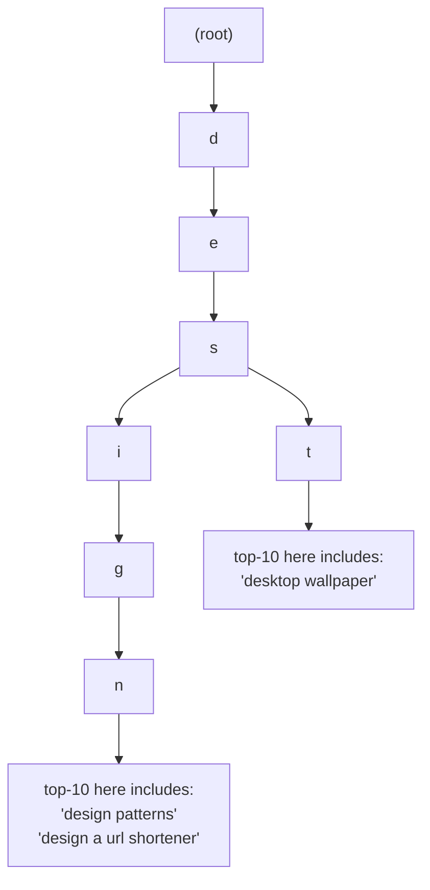
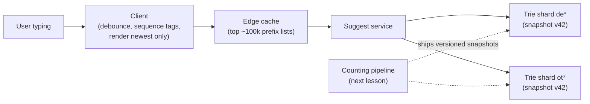
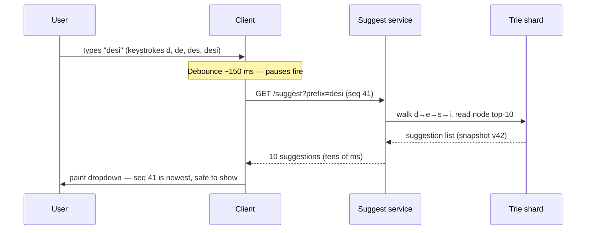

export const meta = {
  slug: 'search-autocomplete',
  title: 'Design Search Autocomplete: Suggestions Before You Finish Typing',
  tier: 'intermediate',
  order: 12,
  summary:
    'The second great interview classic: a system that guesses your search before you finish typing — a trie with precomputed top-k answers, sharded and cached until a million lookups a second feel like nothing.',
  estimatedMinutes: 20,
  difficulty: 3,
  topics: ['system design', 'interview', 'search'],
};

## The day search started answering before the question

September 8, 2010. Marissa Mayer is on stage typing into a search box — slowly,
theatrically. Behind her, the results
page is changing *while she types*, before she presses Enter, before she even finishes
the word. The feature was called Google Instant, and Mayer called it "a fundamental
shift in search." ✅ The room understood the demo instantly, because everyone in it had
felt the friction it removed: type, stop, wait, read, retype. Instant made the page keep
up with your fingers.

Here's the part people forget: Instant had two halves. One half re-ran the search on
every keystroke and repainted the results — that half died in July 2017, when Google
removed it because of mobile. ✅ The other half — the dropdown of predicted searches under
the box — never died. It's on your phone right now. It survived because it wasn't a
gimmick; it was a data structure with an opinion about what you're about to say, and it
was right often enough to save the world real time.

That dropdown is this lesson's system. It looks like the simplest feature on the
internet. It is quietly one of the hardest: it must answer on *every keystroke*, for
*every user*, in less time than the user needs to type the next letter — and what it
answers with is a ranked summary of what billions of people have asked before you.
This lesson designs the serving half: how the answer is ready before the question.
The next lesson designs the learning half: where the answers come from, and how the
system keeps them fresh — and keeps them from embarrassing you.

## Why this matters

"Design search autocomplete" (interviewers also call it *typeahead*) is the second
great interview classic, the natural sequel to the [URL shortener](/lesson/url-shortener/).
The shortener tested whether you can mint and look up keys. Autocomplete tests
everything else at once:

- **A data structure under a latency gun.** You will reach for a trie — a tree where
  each step down adds one character, so every path spells a prefix — and then
  discover the trie is the easy part.
- **A read path that out-traffics the product it serves.** Every search becomes roughly
  ten suggestion requests. The tail wags the dog: your lookup tier absorbs ~10× the
  search engine's own query rate. 🔢 (The math is below; check it.)
- **A serving tier that may never improvise.** At this request rate and this latency
  budget, there is no time to *compute* an answer per keystroke. The answers must
  already exist. Almost every design decision in this lesson is that sentence,
  applied.

If the URL shortener was a coat-check counter, autocomplete is the friend who finishes
your sentences. Let's meet the friend properly.

## First, clarify the problem

The system does exactly one thing:

1. **Complete the query.** The user has typed a prefix — `desi` — and the system
   returns the ~10 most likely full queries that start with it: *design patterns*,
   *design a url shortener*, *designer bags*… The user picks one (or ignores the list
   and keeps typing).

Everything else is a follow-up to park, exactly as you parked analytics on the
shortener:

- **Actually running the search?** No. We produce the query text; some other system
  executes it. Our API is `GET /suggest?prefix=desi` → a ranked list of strings.
- **How fast?** This is the requirement that designs the system: suggestions must feel
  instant. Human perception gives us the number — under about **0.1 seconds** a system
  feels like it's reacting instantaneously, and **1.0 seconds** is the limit for
  keeping the user's flow of thought uninterrupted. ✅ (Jakob Nielsen's response-time
  limits, unchanged since 1993.) Our budget: once a request fires, the full round
  trip, network included, lands in **under ~100 ms**, which leaves the server only
  tens of milliseconds to do its work. Bloomberg's question-answering autocomplete
  reports completions typically "in no more than 60 to 80 milliseconds," spelling
  correction included. ◐
- **How big?** Fix the scale now, as always: let's say **5 billion searches a day** on
  our engine, worldwide, many languages. Hold that number; the math section spends it.
- **Personalized?** Park it — with a note. Real systems blend in your own history
  (Google's help page lists language, location, trending interest, and your past
  searches as the factors its predictions use ✅). The next lesson shows where the
  per-user list merges in; this lesson serves global popularity first.
- **Fresh?** A suggestion list frozen last month misses this morning's breaking news.
  Freshness is the *next* lesson's whole subject; here, just register that the serving
  tier must leave a door open for it.

<VideoCard videoId="fk5PFtdYA8U" title="Design Search Autocomplete (Typeahead) — System Design Interview" source="The Hot Path" description="The full problem worked end to end: capacity numbers, the tree of prefixes, precomputed suggestions per prefix, and the ranker — this lesson's design, drawn out loud." />

## Picture a friend who finishes your sentences

This lesson's running analogy: **a friend who has heard every sentence ever started,
and finishes yours before you can.**

You know this friend. You say "do you know where the—" and they're already saying
"—station, two blocks left." How do they do it? Not by magic, and not by searching a
filing cabinet mid-conversation. Two of their habits carry this whole lesson:

- **They've heard it all before.** Every finished sentence anyone has said in their
  hearing is tallied somewhere in their memory. Suggestions in our system are likewise
  *previous searches*, counted — the counting itself is the next lesson.
- **For every half-sentence, they keep a shortlist ready.** They don't compose your
  ending on the spot; for common openings, the likely endings are pre-ranked in their
  head, and out one comes. That's our precomputed top-k list per prefix — the k highest-ranked
  completions for that prefix, k = 10 in this design — and it's the design's
  beating heart.

(The friend's other two habits — keeping up with the times, and having tact — run the
next lesson.)

Keep the friend in mind. Every component below is one of their habits, mechanized.

## Back-of-envelope math: the tail that wags the dog

Start from the scope: **5 billion searches a day.** The course's rounding rule: a
day ≈ 100,000 seconds (the estimation lessons show why this rounding is honest).

**The searches themselves:** 5,000,000,000 ÷ 100,000 ≈ **50,000 searches/sec** on
average; call peak 2×, so **~100,000/sec**. 🔢 Respectable, not terrifying.

**The suggestion requests:** here's the multiplication that designs the system. A user
typing a query fires a request per keystroke once the prefix is a couple of characters
long. Say the average query is ~15 characters and the client asks on ~10 of those
keystrokes. Then every search becomes **~10 lookups**: 50,000 × 10 = **500,000
lookups/sec average, ~1,000,000/sec at peak.** 🔢 Read that again. The *suggestion*
tier — the decorative dropdown — must absorb ten times the request rate of the search
engine it decorates, and each answer is due in tens of milliseconds. This is the whole
design problem in one line: **a million tiny lookups a second, each one essentially
free, or the feature is a liability.**

One sizing note: those rates are the load that actually arrives at the fleet —
counted *after* the client's debounce has already suppressed mid-burst keystrokes
(the ~10 requests per search above are requests that fired, not raw keystrokes).
Size for these.

**The corpus:** suggestions come from queries people actually ran. Suppose we keep the
**top 2 billion distinct queries** by popularity (the tail beyond that is typed too
rarely to be worth suggesting — and a Google spokesperson said about 15% of daily
searches are brand new ◐ (via CNET, December 2016), so the tail is genuinely endless). Store
each as ~25 bytes of text plus a count and timestamps, ~40 bytes all-in: 2 × 10⁹ × 40 B
≈ **80 GB**. 🔢 That is *small* — it fits in RAM across a modest fleet. The corpus is
not the problem. The corpus **organized for prefix lookup** is the problem, and it's
the next section.

**The prefix explosion (why you can't cheat):** the lazy design is a hash map from
every possible prefix to its suggestion list. Count the keys: 2 billion queries × ~15
prefixes each ≈ **30 billion prefix entries**. 🔢 No. The entries must share structure
— every query starting `how to` must live under the same `how to` path, stored once.
Data structures that share prefixes have a name, and it's the next section's entire
subject.

## The crux: a trie that answers, not searches

A **trie** (from re**trie**val) is a tree where each edge is a character and each path
from the root spells a prefix. Walk down `d → e → s → i` and you're standing on every
query that starts with `desi`; the subtree under you is exactly your candidate set.
The structure is old and it's still the answer — but a bare trie only tells you *which*
queries match. Serving needs the **top 10 by rank**, per prefix, in microseconds. So
the production trick, the sentence this lesson exists to teach:

> **Precompute the answer at every node.** Each trie node stores the top-k (k = 10)
> suggestion IDs for its prefix, ranked offline. Serving is then: walk the prefix,
> read the list, done — no sorting, no scanning, no ranking at request time.

The cost moves to build time, where it belongs: a batch process recomputes every
node's list from the query counts. The read path becomes a memory walk — one step
per prefix character — plus one small list read: microseconds of work, which is how
you afford a million of them a second at peak. The research-grade version of this idea — squeezing the structure
into a succinct index so it fits in memory at web scale — is Bast & Weber's SIGIR 2006
paper — the succinct-index approach to autocomplete search. ✅

<StepThrough
  title="Three ways to answer 'what starts with desi?'"
  nodes={[
    { id: "scan", label: "Scan all queries", x: 80, y: 150, w: 130 },
    { id: "hash", label: "Hash map of prefixes", x: 240, y: 150, w: 150 },
    { id: "trie", label: "Trie + precomputed top-k", x: 400, y: 150, w: 160 },
  ]}
  edges={[
    { from: "scan", to: "hash" },
    { from: "hash", to: "trie" },
  ]}
  steps={[
    {
      title: "Strategy 1: keep a sorted list, scan or binary-search it",
      caption: "Store all 2 billion queries sorted; a prefix lookup binary-searches to the first match — then reads forward collecting candidates and ranking them on the spot. The search is fast, but every request pays for ranking work, and the hottest prefixes re-pay it up to a million times a second at peak. Ranking at read time is the cost we're trying to delete.",
      highlight: ["scan"],
    },
    {
      title: "Strategy 2: hash map from prefix to suggestion list",
      caption: "Precompute a list for every prefix and store them in a giant hash map. Reads are one lookup — but ~30 billion distinct prefixes means the map is astronomically larger than the corpus, and most entries are never asked for. You precomputed answers to questions nobody poses.",
      highlight: ["hash"],
    },
    {
      title: "Strategy 3: trie with top-k stored at each node",
      caption: "Prefixes share paths, so the structure stores each distinct prefix once; each node carries its own precomputed top-10. Serving = descend the prefix, read the list. Memory stays in the tens of GB, reads are memory-speed, and ranking cost is paid once per rebuild, not once per keystroke. This is the design.",
      highlight: ["trie"],
    },
    {
      title: "What the interviewer wants to hear",
      caption: "Name the naive options and kill them with arithmetic: per-request ranking fails the latency budget at ~10^6 lookups/sec at peak; the all-prefixes hash map fails the memory budget at ~30 billion keys. The trie is what's left standing — and precomputing top-k at the node is the move that makes it a product instead of a data structure.",
      highlight: ["scan", "hash", "trie"],
    },
  ]}
>
</StepThrough>

A pocket-sized piece of the trie, for three queries that start alike:

Two refinements keep the trie honest at scale:

- **Compression.** A naive node-per-character tree wastes memory on long unique
  suffixes (the tail of `design a url shortener` has one tenant). A **radix (Patricia)
  trie** collapses single-child chains into one edge labelled with the whole string —
  same answers, a fraction of the nodes.
- **IDs, not strings.** Nodes store suggestion *IDs*; a side table maps ID → query text
  and its current score. Rebuilds then shuffle small integers instead of copying
  strings, and the ranking layer can re-score without touching the tree's shape.

## Ranking, in one paragraph (the next lesson gives it a chapter)

The node's top-10 is ordered by a score computed offline: **decayed frequency** (how
often the world asked this, recent days weighted up, log-scaled so giants don't crowd
out the merely popular), plus a **trending boost** for queries suddenly running far
above their baseline. And one component is not a score at all: a **policy gate** —
whatever the numbers say, a suggestion flagged as hateful, explicit, or dangerous does
not ship. Frequency proposes; policy disposes. Why the gate is load-bearing, and what
happens on the one famous occasion it was missing, is the next lesson's opening story.

## Sharding the trie, caching the obvious

**Shard by prefix.** The 80 GB corpus splits across a fleet by the opening
characters of the prefix: in the baseline split, one shard owns every `a*` prefix,
another every `b*`, and so on. A request routes by its prefix to exactly one shard —
no scatter-gather (sending the same request out to many shards and merging their
replies): the prefix itself picks the shard, so there is no fan-out and no merge
step. The trap is skew: prefixes are not created equal. `a`, `how`, and whatever
this morning's headline starts with will hammer their shards while `qzx` idles.
Defences, in order of escalation: shard by *two* characters — separate shards own
`aa`, `ab`, `ac`, … (676 = 26 × 26 pairs in a simplified 26-letter alphabet; a real
multilingual fleet normalizes text and buckets by opening-character ranges across
scripts), replicate the hot shards read-only, and let the cache absorb the celebrity
prefixes entirely.

**Cache in three places, because the math begs for it.** Query popularity is brutally
skewed — a small head of prefixes serves an outsized share of all keystrokes (exactly
how outsized varies by engine; the steep-head, long-tail shape doesn't). So:

1. **At the edge / in the serving tier:** the top ~100,000 prefixes' lists, cached in
   memory. Assume one cached list runs ~350 bytes (ten short query strings plus
   overhead): 100,000 × 350 B = 35,000,000 B ≈ **~35 MB** 🔢 — pocket change that
   absorbs a large share of the firehose before it reaches a trie.
2. **In the client:** debounce. The client waits ~150 ms after the last keystroke
   before firing, so a keystroke superseded inside that window never becomes a
   request at all — mid-burst, most keystrokes are superseded, and only a pause lets
   a request out. And **tag every request with a sequence number**: responses that
   arrive after a newer one are *discarded*, so a slow answer for `des` never
   overwrites the fresh one for `desi`. Stale pixels are worse than no pixels.
3. **Negative space, briefly:** a prefix with no completions (`qzx…`) is a real
   answer — cache it too, with a short TTL (time to live: how long the cached
   "no completions" answer may be reused before it's thrown away and asked again),
   or every fast typist re-asks the fleet the same unanswerable question.

## The full walkthrough: one keystroke, end to end

A user types `desi`, one keystroke at a time, on a healthy system:

1. **Keystrokes `d`, `de`, `des`:** the user hesitates slightly between characters —
   just long enough for two requests to escape: #39 for `de`, #40 for `des`. (The
   first lone letter fires nothing; one character has no useful completions, and the
   debounce window swallows it.)
2. **`desi` lands, ~150 ms of quiet:** the client fires `GET /suggest?prefix=desi`
   tagged sequence #41. The answers to #39 and #40 are still in flight — when they
   land, their sequence tags mark them stale and they are discarded unpainted.
3. **Edge:** the request hits the nearest serving point. `desi` is a head prefix, so
   its list is likely in the edge cache — a hit ends the journey here.
4. **Trie shard:** on a cache miss, the request routes by prefix to the shard owning
   `de`, which walks d→e→s→i in its in-memory radix trie and reads the node's stored
   top-10 IDs. No disk. No ranking. A list read.
5. **Response:** ten strings, a few hundred bytes, back to the client — which checks
   the sequence tag (still the newest? good) and paints the dropdown.

Budget check against the 100 ms promise:

| Leg | Cost | Note |
|---|---|---|
| Debounce wait | ~150 ms, before the request fires | Deliberate, and outside the 100 ms budget: the price of not firing per keystroke. The budget clock starts when the request fires |
| Network round trip | ~20–50 ms | Geography, not engineering, sets most of this |
| Cache hit or trie walk | ~1–10 ms | In-memory on both paths — that's the design working |
| **Response after firing** | **tens of ms** | Inside the ~100 ms feel-instant budget ✅ |

The system feels instant not because any single part is heroic, but because no part is
allowed to be slow: the expensive thinking — counting, ranking, screening — all
happened *before* the keystroke. Where it happens is the next lesson.

One term the diagrams below use: a **snapshot** is one complete, self-contained
built copy of the trie — the tree, its top-k lists, the ID table — stamped with a
version number (v42 below) naming which copy a node is serving. Nodes swap
snapshots **atomically**: the old copy keeps answering until the new one is fully
loaded, then a pointer flips. A half-loaded index is never served.

## Takeaways

1. Autocomplete is a lookup service wearing a search costume: ~10 lookups per search
   means ~10⁶ lookups/sec at peak 🔢, each due in tens of milliseconds — so all
   expensive thinking happens offline, and the read path only walks and reads.
2. The data structure is a **trie with the top-k answers precomputed at every node**;
   the all-prefixes hash map dies by arithmetic (~30 billion keys 🔢) and per-request
   ranking dies by latency.
3. Serving stays honest at scale by sharding the trie by prefix, replicating and
   caching the skewed head (edge cache, client debounce, cached empty results), and
   tagging every response with a sequence number so stale answers never paint.
4. The snapshot the fleet serves is *built*, not live-edited — versioned, swapped
   atomically. Building it well is a whole second system, and it's the next lesson.

<Quiz
  lessonSlug="search-autocomplete"
  questions={[
    {
      question: "At 5 billion searches a day with ~10 fired suggestion requests per search (post-debounce), roughly how many lookups per second must the suggestion tier absorb at peak?",
      options: [
        "About 50,000 per second — the same as the search rate",
        "About 100,000 per second",
        "About 1,000,000 per second",
        "About 10,000,000 per second",
      ],
      correctIndex: 2,
    },
    {
      question: "Why does the production design store a precomputed top-10 list at every trie node instead of ranking matches when a request arrives?",
      options: [
        "Ranking at request time would blow the tens-of-milliseconds budget when repeated a million times a second; the node list turns serving into a walk and a read",
        "Tries cannot store ranked data, so the list has to live outside the tree",
        "It makes the index smaller, because top-10 lists compress better than queries",
        "Interviewers expect it, even though it is slower in practice",
      ],
      correctIndex: 0,
    },
    {
      question: "A user types fast and the network delivers the answer for 'des' after the answer for 'desi'. What keeps the UI correct?",
      options: [
        "The server processes prefixes strictly in the order typed",
        "Each request carries a sequence tag and the client paints only the newest response, discarding stale ones",
        "The debounce guarantees responses can never arrive out of order",
        "The trie returns the same list for both prefixes, so order doesn't matter",
      ],
      correctIndex: 1,
    },
    {
      question: "Prefix traffic is heavily skewed — a few prefixes get a huge share of keystrokes. Which defence does NOT belong to the serving design for that skew?",
      options: [
        "Caching the top prefixes' lists at the edge",
        "Replicating hot trie shards read-only",
        "Sharding by two characters instead of one for finer grain",
        "Ranking matches at request time so hot prefixes get fresher ordering",
      ],
      correctIndex: 3,
    },
  ]}
/>

---

## Go deeper

- [Design a URL Shortener](/lesson/url-shortener/) — the first case study: the same
  clarify → estimate → decide arc on a smaller system, and the sharding-by-key pattern
  this lesson's trie shards inherit.
- [Caching Strategies](/lesson/caching-strategies/) — the head-heavy skew this lesson
  exploits, treated properly: eviction, TTLs, and the thundering herd.
- [Back-of-the-Envelope Estimation](/lesson/back-of-envelope-estimation/) — the
  fan-out multiplication that sized this whole design is Step 2's two-minute math,
  weaponized.

## Sources & further reading

- Google Search Help, "How autocomplete predictions work" (support.google.com) — from
  the source: predictions reflect real searches, weighted by language, location,
  trending interest, and your past searches, with policy-violating predictions removed.
  Read it to keep your interview answer aligned with what the real system admits to.
- Search Engine Land, July 2017, reporting Google's removal of Google Instant — the
  primary record (with Google's own statement) of why the results-per-keystroke half
  died on mobile while suggestions survived.
- Holger Bast and Ingmar Weber, "Type Less, Find More: Fast Autocompletion Search with
  a Succinct Index," *Proceedings of SIGIR 2006*, pp. 364–371 —
  how to make prefix search fast *and* memory-lean at web scale. The intellectual
  parent of every production typeahead index.
- Konstantine Arkoudas and Mohamed Yahya, "Auto-completion for Question Answering
  Systems at Bloomberg," *SIGIR 2018 Industry Days* — a production question-answering
  autocomplete reporting completions typically in no more than 60 to 80 milliseconds
  per keystroke, spelling correction included; proof the latency numbers in this
  lesson are industry numbers, not classroom ones.
- Jakob Nielsen, "Response Times: The 3 Important Limits," Nielsen Norman Group (from
  *Usability Engineering*, 1993) — 0.1 s feels instant, 1 s keeps thought flowing,
  10 s loses attention. Thirty years old and still the budget every interactive system
  is designed against.
- Martin Kleppmann, *Designing Data-Intensive Applications* (O'Reilly, 2017), Ch. 6
  (Partitioning) — the theory under sharding an index by key range, hotspots included.
