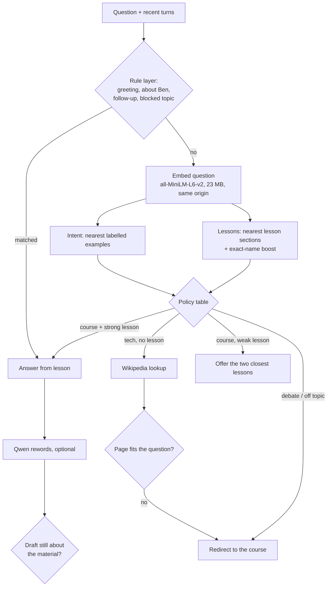

# ADR 0001: Ben decides by meaning, in the browser

- Status: accepted
- Date: 2026-09-24
- Scope: the local tutor (`src/ai/local/`, `QaWidget.tsx`)

## Context

Ben answered "Should we be studying science in Catholic schools?" with the Zero Trust lesson and
labelled it "High confidence". The cause was structural, not a single bug:

1. **Every decision was lexical.** Scope, lesson choice, and "should we search the web" were BM25
   scores and regexes. The question was never read for meaning. Filler words ("because",
   "everything") that happened to appear in a lesson card were enough to pass the scope gate.
2. **The model could not take those decisions over.** Qwen2.5-0.5B is the largest generator a
   phone browser can reasonably download. It is too weak to plan or call tools reliably, so the
   design kept it downstream, rewording text that had already been chosen.
3. **Nothing measured routing.** Each fix answered one screenshot. Tests asserted hand-picked
   strings, so a fix for one phrasing could not show whether it broke ten others.
4. **Qwen never actually ran in production.** The page CSP (`script-src 'self'` plus one hash)
   blocked the runtime import from jsDelivr, so every reply Ben ever gave was the raw keyword
   pipeline text. Found by running the chat in Chromium while building this change.

Constraints that stay fixed:

- **No cloud model.** Nothing the student types goes to a model API. GitHub Pages serves static
  files only.
- **Phones matter.** The reported failure was on a phone, so a multi-GB in-browser LLM is out.
- **Lessons, quizzes, and progress must work with Ben absent or broken.**

## Decision

Split Ben into an **understanding layer** that runs a small embedding model and a **wording
layer** that stays optional. Every routing decision is made by the first layer, before Qwen is
downloaded.

### 1. Embedding model, served by the site itself

- `Xenova/all-MiniLM-L6-v2`, quantized (`onnx/model_quantized.onnx`, 384 dimensions).
- Served from `public/models/all-MiniLM-L6-v2/`, the same origin as the course.
- Every file is pinned by SHA-256 in `scripts/ben/embedder.mjs`. `npm run ben:index` fetches from
  Hugging Face (or a local copy via `BEN_EMBEDDER_DIR`) and refuses a file whose hash differs.
  The files are gitignored and fetched at build time, so no 23 MB binary lives in git.

### 2. The runtime is part of the site

- `@huggingface/transformers` is bundled by Vite into a lazy chunk that loads only when the chat
  opens. The ONNX WASM files are copied from the same installed `onnxruntime-web` into `ort/`.
- Devices with WebGPU get the asyncify build (27 MB, needed for WebGPU). Devices without it,
  most phones among them, get the plain build (14 MB). Only one is downloaded.
- **Except on a host that caps asset size.** The asyncify WASM is 25.6 MiB and Cloudflare Workers
  caps one static asset at 25 MiB, so a build with `WORKERS_CI=1` set (Cloudflare Workers Builds)
  leaves that pair out of `ort/` and serves the plain build to WebGPU devices too. GitHub Pages, the
  target of record, has no such cap and keeps the asyncify build. `vite.config.ts` asks
  `asyncifyShipped()` whether `ort/` holds the pair and bakes the answer into the bundle, so the page
  never requests a runtime the build did not ship. A file over the cap fails at Cloudflare's *deploy*
  step with no error line naming it, so check any new large asset (audio, a model) against 25 MiB.
- The CSP keeps `script-src 'self'`. It gains `'wasm-unsafe-eval'`, which permits WebAssembly
  compilation and nothing else (not `eval()` of JavaScript). The runtime's blob-URL WASM cache is
  off because the CSP forbids `blob:` scripts; the browser's HTTP cache still applies.
- Model loads are serialized (`src/ai/local/runtime.ts`). Transformers.js reads its local/remote
  settings from one global on every file fetch, and the two models come from different places.
- Qwen's weights still come from the Hugging Face Hub (a `fetch`, allowed by `connect-src`).
  That is data, not code, and only happens when Qwen rewords an answer.

### 3. Lesson index built at build time

`scripts/ben/build-index.mjs` splits every `content/lessons/*.mdx` into sections at `##`/`###`
headings, embeds each section, and embeds the labelled intent examples. It writes
`public/ben/index.json` (int8 vectors with per-row scale, base64). The file is regenerated on
every build, so it cannot drift from the lessons. The browser fetches it when the chat opens.

The index covers the **full lesson text**, not the one-paragraph cards. The cards still drive
the spoken answer shapes (analogy, example, simpler). The sections give Qwen richer material.

### 4. Router: a pure function with a visible policy

`src/ai/local/semantic/router.ts` takes the question vector, the index, and the rule-layer
signals. It returns a `Decision`: intent, action, ranked lessons, and the reasons behind it. It
does no I/O, so it is unit-tested with synthetic vectors and evaluated with real ones.

| Intent (k-NN vote) | Lesson similarity | Action |
|---|---|---|
| greeting / about Ben / follow-up (rules) | any | answer as Ben |
| blocked topic (rules) | any | redirect |
| debate or off topic, confident | below the "named it" bar | redirect |
| course or tech | at or above the lesson bar | answer from the lesson |
| how-to intercept (amendment below, dual trigger) | below override-grade | `howto` |
| course | below the bar, above the clarify bar | offer the two closest lessons |
| tech | below the bar | Wikipedia lookup, then fit check |
| tech / course, no lesson at any bar (`parametric_fallback`) | below the clarify bar | tool loop (amendment below, branch 16) |
| how-to intercept (amendment below, dual trigger) | below override-grade | `howto` → tool loop once the OS is known (branch 16) |
| anything else | low | redirect |

An exact lesson name ("MVC", "RPO", "Raft") adds a fixed boost, but only in short questions
(three content words or fewer). Acronyms embed poorly; in a full sentence, a title word such as
"client" is not a name, and boosting it sent a rate-limiting question to the BFF lesson.

The rule layer runs first but is not absolute: an "about Ben" rule match loses to a confident
debate or off-topic vote ("Is it ever okay to lie to your boss?" is not about Ben's boss). The thresholds live in one exported object and are tuned against the eval set, never
against a single screenshot.

#### Amendment (2026-11-12, F2 increment): the `howto` action and the pre-lesson-bar intercept

Added by branch `fix/ben-howto-route` under the Consensus Manifest of 2026-11-12 (Part II,
branch 3; council record `docs/council/2026-11-12-ben-howto-route.md`). This increment adds
the policy-table row above and this subsection; the tool loop that consumes the new action is
a later increment (branch 16 — the arena record's stray "branch 15" references to this
placement mean branch 16 under the final numbering; erratum recorded in the council record).

**The class.** Questions that ask Ben to *do* an install or a set-up — "install docker",
"how do I install docker", "install kubernetes", "set up kafka locally" — had no designed
path. Measured at HEAD (Phase 1 interrogation §7 probe, 2026-11-12, verified), one class
returned `parametric_fallback`, `redirect`, `lesson`, or `clarify` depending on phrasing —
including a conceptual lesson presented as the answer to an install request. `howto` is a
routing action for that class: it marks the turn for the tool route (official install
documentation, retrieved and fit-checked under §5 when the loop lands). Until that loop
lands, the turn layer answers honestly from no source rather than dressing a lesson up as
instructions.

**The intercept, and why it is not "more regexes and stopwords".** The Alternatives section
rejected regexes because each one fixes a phrasing, not the class, and a regex verdict is
final. This intercept is the recorded exception, built so a regex can never decide alone:

1. **Dual trigger.** An imperative signal — the install/set-up verb in verb position —
   *arms* the intercept; an embedding-derived semantic signal must also fire: the k-NN vote
   winner is `tech` or `course`, or the question embeds within a low proximity floor
   (unboosted best lesson-chunk similarity ≥ 0.15, far below the 0.33 clarify bar) of the
   lesson index. Regex alone never routes, and the embedding alone never routes to `howto`
   either: a definitional "what is docker" has no imperative signal and stays
   `parametric_fallback`. The pattern matches the verb position, not the tool's name, so it
   covers the class rather than one phrasing of it.
2. **Lesson override survives.** A lesson match at override-grade strength beats the
   intercept; the intercept wins ties and weak matches only. Override-grade is numeric:
   *unboosted* best-section similarity ≥ 0.62 (`THRESHOLDS.override`). The +0.08 name boost
   does not count toward it — the boost is a lexical pin for acronym-short questions, and
   counting it would exempt the measured worst case ("install kubernetes": 0.639 boosted,
   0.559 unboosted, §7 probe).
3. **No silent OS assumption.** Install steps are OS-specific (verified for the class's
   seeded tools: Docker, Kubernetes, and Kafka each publish per-OS install/setup paths —
   the official-docs sources recorded on the branch-2 held-out cases). When a `howto`
   question names no operating system, the decision carries `osUnspecified` and Ben asks
   exactly one clarifying question — which OS — instead of assuming one. When an OS is
   named ("on ubuntu"), no question is asked.

Existing classes keep their routes: the intercept runs after the rule layer and the
named-tag pins (tutor set-up questions, including the AI-environment family, are never
intercepted), so no pin is stolen.

**Exception to the closing rule.** Consequences below says new failure reports should
become new held-out cases first, then new examples, "never a new regex". That sequence held
here — the class was written as held-out cases first (branch `test/ben-howto-heldout`) and
this fix is gated on them — and the regex here only arms a decision the embedding layer
must confirm. Any further regex-shaped routing change is outside this exception and needs
its own ADR amendment and council record.

#### Amendment (2026-11-12, Ben increment): the code-driven tool loop (Shape C as amended)

Added by branch `feat/ben-agent-loop` under the Consensus Manifest of 2026-11-12 (Part I §I.6,
Part II branch 16; council record `docs/council/2026-11-12-ben-agent-loop.md`). This is the
increment the F2 amendment above anticipates: the loop that consumes the `howto` action and
the `parametric_fallback` route. (The arena record's stray "branch 15" references to this
placement mean branch 16 under the final numbering — erratum recorded in the council records.)

**Shape.** The router stays sovereign. A code-driven loop serves **only** the
`parametric_fallback` route and the `howto` route (once the OS question is answered). Lesson,
clarify, self, and redirect turns are untouched, and the grounded-first invariant holds: the
loop never blocks or replaces a grounded answer — it runs only where no grounded answer
exists. The deterministic steps are: lesson **re-retrieval** (the existing embed/rank over the
lesson index) → **Wikipedia lookup** (below) → **synthesis** by a model over the retrieved
sources, or an **extractive** answer assembled from those sources when no model is available.
Code decides every tool call; the model synthesises only — it never chooses tools, never
emits a citation, and never sets the confidence vote. Native model function-calling is not
used (WebLLM's is documented work-in-progress).

**The Wikipedia exception — a declared posture reversal.** `docs/ben-history.md` §6 records
that Wikipedia was deliberately removed as "the last network dependency… not compatible with
the client-side mandate", and this ADR's fixed constraints say nothing the student types goes
to a model API. This amendment names the single exception: on the tech/parametric path only
(the two loop routes), Ben may call the **Wikipedia API** — the only keyless, CORS-clean,
full-text-searchable source available to a browser page; no other external service is
authorised, and DuckDuckGo is banned in any role (not search; CORS-inconsistent;
terms-encumbered). The exception ships only with its conditions, which are part of the
decision, not implementation detail:

- **Query minimisation by construction.** Code derives a canonical topic term from the
  question's content tokens (for the how-to class, the tool named after the install
  phrasing). The student's sentence is never sent, so nothing personal in it can leave.
- **First-use disclosure + remembered opt-out.** The first answer that uses Wikipedia says
  so in the chat and says only the topic word was sent; a student's no-web request is
  remembered and degrades the loop to re-retrieval + extractive answers.
- **Fit check.** The §5 web-fit check applies (0.25 bar + title relevance, above).

**Citations and confidence are code's, on both paths.** Citations are assigned by code from
the sources actually retrieved this turn — a citation for an unretrieved source is a defect
of the highest order here. Confidence is computed by code under one shared post-condition,
applied identically to the synthesis and extractive paths so they cannot diverge: **sources
empty ⇒ forced low, with the no-source wording**; the model may propose wording, never a
higher vote. UI copy names the step actually running ("Checking the lesson first…",
"Looking that up on Wikipedia…"); "thinking"/"reasoning" claims are banned — the loop is a
pipeline, not a deliberation.

**Model ladder, pinned — with the WebLLM tier DEFERRED.** Synthesis prefers the browser's
built-in model, found by feature detection (`LanguageModel.availability()`), never by
user-agent sniffing; a state change mid-session requires consent before any browser-model
download. The WebLLM fallback is pinned by exact model ID — `Qwen3-1.7B-q4f16_1-MLC`
(normal) / `Qwen3-0.6B-q4f16_1-MLC` (weak-device rung) — with sizes disclosed and consent
taken before any download (sizes carry the **likely** confidence mark: secondary sources
only, Part I fact #2 of the arena record). A config lookup that finds neither pin fails
loudly; the previous `startsWith('Qwen2.5-0.5B-Instruct')` lookup is retired as a
silent-disable fragility. **Deferral (Seat C trigger):** Qwen3's output hygiene under WebLLM
(no leaked think traces, token budget) cannot be verified in-branch — the existing output
gate has no think-trace handling and the engine's thinking-mode control is undocumented — so
the WebLLM synthesis tier **does not ship in this branch**: the ladder and pins are
implemented and unit-tested, but the production WebLLM load keeps the current model (now
selected by exact ID) until a real-device pass verifies the Qwen3 tier. The branch ships
Prompt-API synthesis + extractive answers.

**§7 reproducibility note.** The 2026-10-25 record that sandbox regenerations of
`evals/ben/REPORT.md` "do not reproduce" predates the deterministic-embeddings fix (#180).
On branch 3 (2026-11-12) a fresh `npm run eval:ben` at the branch head left the regenerated
REPORT.md byte-identical, so regeneration is treated as reproducible and rides any branch
that runs the eval, generated by the command and never hand-edited, with the holdout-only
line quoted wherever the combined numbers appear.

### 5. Tools are checked after they run

- **Web fit:** the Wikipedia extract is embedded and must clear a similarity bar against the
  question, or it is dropped. That stops "Doctor Who" answers to "who hired you".
  The tool loop (branch 16 amendment below) revives this check for its Wikipedia step: the
  extract must clear 0.25 cosine against the question **and** the result title must share a
  content token with the canonical query term; a disambiguation page fails the title check by
  construction. Either failure discards the result — it is never synthesised from.
- **Draft fit:** Qwen's rewrite is embedded and must stay close to the material it was given,
  or the grounded reply stays on screen.

### 6. Graceful degradation

If the embedder cannot load (offline, blocked CDN, old browser), Ben falls back to the keyword
pipeline (`prepareTurn`) with its guard rails. The confidence line says so. The chat never
blocks on a model download.

### 7. Evaluation is part of the build

- `evals/ben/exemplars.json`: the labelled bank the k-NN votes with. It ships, as vectors only.
- `evals/ben/cases.json`: the diagnosis set. Never shipped, never used for voting. Its misses
  drive changes.
- `evals/ben/holdout.json`: written after the router was tuned and before it was ever scored.
  Scored, never tuned against. When it starts driving changes, fold it into `cases.json` and
  write a new holdout.
- A unit test asserts that no scored question is also a voting example.
- `npm run eval:ben` scores the semantic router **and** the legacy keyword router on the same
  cases. It writes `evals/ben/REPORT.md` (committed, so a routing change shows its metric change
  in the diff) and fails CI below the gates:

  | Gate | Threshold |
  |---|---|
  | Drift: off-course questions answered from a lesson or the web | ≤ 3% |
  | Off-course questions answered with "did you mean one of these lessons?" | ≤ 10% |
  | Accuracy | ≥ 85% |
  | Course questions turned away | ≤ 8% |
  | A correct lesson in the top 3 | ≥ 90% |
  | Beats the keyword pipeline, and the screenshot question redirects | always |

### Results at acceptance

| Pipeline | Accuracy | Drift | Course turned away |
|---|---|---|---|
| Keyword pipeline, all 192 cases | 73.4% | 26.1% | 7.1% |
| Semantic router, all 192 cases | 87.5% | 1.4% | 2.0% |
| Keyword pipeline, holdout only | 70.8% | 30.0% | 13.6% |
| Semantic router, holdout only | 89.6% | 0.0% | 0.0% |

See `evals/ben/REPORT.md` for every current miss.

**A real bug in the first version of this router, found after acceptance:** `voteIntent` summed
raw cosine similarity across the `k` nearest labelled examples. Every question has *some*
similarity to *something*, so `k=7` almost always pulls in a few weak, unrelated neighbours.
Summed linearly, several weak `off_topic` echoes could outvote one clearly closer `course` match
— "how do I pick a partition key" voted 48% off-topic against 42% course, because its two strong
course neighbours (0.34, 0.27) were outweighed by four weaker off-topic ones (0.19, 0.18, 0.17,
0.16), and got redirected. Squaring the weight (`score²` instead of `score`) lets the closest
neighbour dominate instead of being outvoted by noise. That one change accounts for the drop in
both drift and refusal above, confirmed against the *never-tuned-against* holdout set, not just
the diagnosis set.

A second attempt at that session — adding exemplars for phrasings the diagnosis set still missed
("what is the strangler fig pattern", "Is AI art real art?") — improved the diagnosis set
(86.8% → 87.5%) but **dropped holdout accuracy** (89.6% → 85.4%) and broke three previously-correct
holdout cases. That is overfitting to the diagnosis set by definition, so it was reverted. It is
recorded here because it is the concrete version of the rule stated below: a labelled-example fix
is only real if the holdout set, which that fix was never shown, agrees.

## Consequences

**Better**

- Scope and intent come from meaning. Filler words, typos, and phrasing matter much less.
- Routing no longer waits for Qwen, so a phone gets a correct first answer without the 750 MB
  download.
- Every behavior change is measured against the same held-out set.

**Costs**

- The first chat on a device downloads the embedder (23 MB) and the ONNX runtime WASM (14 MB,
  or 27 MB with WebGPU), plus a ~0.47 MB gzipped index. All cached afterwards.
- The deployed site grows by ~64 MB of static files on Pages: the plain WASM (14 MB), the asyncify
  WASM (27 MB) and the model (23 MB). A Cloudflare Workers artifact leaves out asyncify, so it grows
  by ~37 MB. Vite also emitted a duplicate asyncify WASM from onnxruntime's own `new URL(...)`
  reference, another 27 MB, which ORT reads only when the page leaves `wasmPaths` unset — never
  here, so nothing ever fetched it. The `drop-duplicate-ort-wasm` plugin in `vite.config.ts` now
  drops it from every deploy.
- `@huggingface/transformers` becomes a dev dependency (it runs the build-time embedding and the
  eval in Node). It is large (~450 MB in `node_modules`). It never ships to the browser bundle.
- The build now fetches the embedder from Hugging Face (hash-pinned). A Hugging Face outage fails the build
  loudly instead of shipping a Ben without an index.
- k-NN intent is only as good as the example bank. New failure reports should become new
  held-out cases first, then new examples, never a new regex. (One recorded exception: the
  how-to intercept in the §4 amendment of 2026-11-12, where a verb-position pattern only
  arms a decision the embedding layer must confirm.)

**Not solved**

- Ben still does not reason in multiple steps. The understanding layer classifies and retrieves.
  It does not plan. A larger local model can revisit that once phones can run one.

## Alternatives rejected

- **Cloud model (Claude, Workers AI):** best reasoning, but violates the no-cloud constraint.
- **3B-class model via WebLLM:** can plan, but needs WebGPU and 2–4 GB, which fails on phones.
- **More regexes and stopwords:** cheap, but each one fixes a phrasing, not the class of problem.
- **Qwen as a label classifier:** plausible as a tie-breaker later. It needs the 750 MB model
  loaded before routing, which defeats the phone goal.
